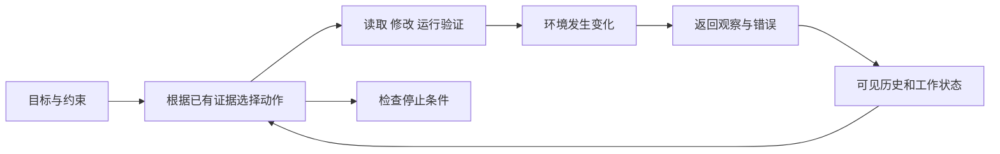

# 第 1 章　Agent 是怎样的一种系统

[教材目录](../README.md) · 下一章：[模型接口与生成边界](02-model-interface.md)

**先修要求：**能阅读函数、条件分支与循环，知道程序可以调用外部接口。**学习目标：**能够用任务、环境、观察、动作和反馈描述一个 Agent；区分工作流与动态决策；为自主执行划定可验证的完成条件和权限边界。

## 1.1 从一个修复请求开始

本书贯穿使用一个合成任务：用户发现 CSV 订单汇总程序的总额算错，要求“修好并验证”。假设代码只累加单价、漏乘数量：`pen` 的单价为 `3.50`、数量为 `2`，`book` 的单价为 `12.00`、数量为 `3`，错误结果是 `15.50`，正确总额应为 `43.00`。这些值是教学设定，不是三个上游项目中的真实缺陷。

若把报错、源码与正确答案一次性塞进模型，再取回一段补丁，得到的是一次模型调用。若程序固定执行“读取指定文件 → 请求补丁 → 应用补丁 → 跑指定测试”，得到的是一个工作流。如果系统能根据第一次测试的反馈，决定补读哪个文件、如何修改、是否需要新增用例、何时停止，那么其中有了 **Agent 决策循环**。关键变化是：后续动作部分地由运行时得到的信息决定。

本书采用工程定义：**Agent 是在给定目标与约束下，根据观察选择动作，接收动作反馈，并继续调整行为的系统。**本书研究的系统使用语言模型参与决策，但 Agent 这一结构不以语言模型为必要条件。工具数量、对话轮数、是否出现“计划”文字，都不足以单独判定一个程序是不是 Agent。

模型也不等于整个 Agent。模型提出读取文件的请求，真正打开文件的是宿主程序；模型提出修改，真正执行修改并检查权限的是工具运行层；模型说“完成”，产品仍要决定是否收束当前轮次。研究这三个项目时，应持续追问：**谁作决定，谁执行，谁记录，谁有权停止？**

## 1.2 用状态、观察和反馈描述行为

先给出一套教学符号。环境真实状态记为 $s_t$，观察为 $o_t$，系统保存的历史与工作状态为 $h_t$，动作是 $a_t$。模型与控制程序共同实现策略 $\pi$：

$$
a_t = \pi(h_t, g, c),\qquad
s_{t+1}=T(s_t,a_t),\qquad
h_{t+1}=U(h_t,a_t,o_{t+1})
$$

其中，$g$ 是目标，$c$ 是约束，$T$ 描述环境如何变化，$U$ 描述系统如何吸收新证据。这是教学抽象，不是三个项目共同实现的一套类或数学求解器。

CSV 任务的环境包括文件内容、工作目录、测试依赖、当前分支和未提交修改。模型通常只看到了这些状态的一部分：读取一个函数并不等于读取整个项目，看到测试命令不等于知道它已经成功运行。因此这是一个**部分可观测**的问题。所谓“理解仓库”更准确地说，是基于已经取得的观察形成了暂时判断。

反馈也不必是一个奖励分数。命令退出码、异常栈、工具拒绝、用户补充需求、文件版本变化，都可成为反馈。退出码为零是某次命令执行的证据；它不是“用户目标已达成”的同义词。若测试文件中的数量始终为 1，绿灯不能排除漏乘数量的缺陷。

这一结构要求我们把**世界事实**与**关于事实的文字**分开保存。“我将运行测试”只是承诺；工具返回的命令、退出码与输出才是执行观察；“全部通过”则是对观察的解释。三者在日志里可以相邻，证据地位却不同。

## 1.3 工作流与 Agent 可以组合

工作流把主要路径提前编码，例如要求每个补丁都经过测试；Agent 在允许的范围内选择路径，例如选择要读取的文件或要补充的边界用例。两者不是互斥产品分类。一个系统完全可以让模型动态诊断问题，同时由确定性的工作流控制“应用前必须检查文件版本”“提交前必须通过指定验证”。

动态选择提高了处理未知问题的灵活性，也增加了可变行为。提前固定所有路径容易限制诊断能力，而把所有决定都交给模型则难以维持稳定约束。合理的设计通常是：把**不可协商的约束写进程序**，把**依赖任务语义的选择交给模型**，并让每一次选择都能被环境反馈纠正。

在 CSV 任务中，运行层可以硬性拒绝修改工作区以外的文件；模型可以自行判断应补测负数还是空行。金额究竟允许几位小数、空数量应该报错还是视为零，属于业务契约；源码与已有测试不能消除歧义时，应显式提出问题或记录假设，不能用“自主性”替代需求决定。

## 1.4 自主性必须分维度讨论

“更自主”不是一个单一开关。至少需要分别描述目标解释、动作选择、执行权限、持续时长与外部影响。允许自主搜索项目，不自动等于允许推送代码；允许运行测试，不自动等于允许安装系统依赖；允许持续修复，不意味着无限预算。

可用下列任务契约约束本例：

| 契约部分 | 本例的教学设定 | 可检查的证据 |
| --- | --- | --- |
| 目标 | 按单价乘数量计算订单总额 | 给定输入得到 `43.00` |
| 范围 | 当前工作区的汇总模块及必要用例 | 文件差异清单 |
| 动作 | 读文件、修改、运行本地测试 | 工具调用与结果 |
| 完成条件 | 原缺陷复现后修复，相关用例通过 | 修复前失败与修复后成功的记录 |
| 停止条件 | 完成、被取消、权限不足、预算耗尽 | 明确的终止原因 |

完成条件描述“想要什么结果”，停止条件描述“为什么现在不再继续”。权限不足时停止可能是正确行为，但它不意味着缺陷已修复。这一区分会贯穿后面的循环、恢复与评估章节。

## 1.5 在三个项目中寻找这一结构

以下均为固定提交源码观察，不能当作所有版本的永久保证。

**Codex：每次动作依赖一份具体的请求视图。**`run_turn` 在取得步骤上下文后记录变化的世界状态，再从历史生成模型输入并调用 `run_sampling_request`。代码中特意让上下文、工具声明与工具执行共享同一次捕获的视图。这使“模型依据什么选择动作”成为一个可定位的问题，而不是笼统说模型看到了“当前环境”。教学上可把它理解为给部分可观测决策拍一张一致的快照；快照本身不保证随后环境不会变化。见 [`run_turn` 的快照处理，460–506 行](https://github.com/openai/codex/blob/a9b0815167c27ab13719dd12d13b63e02b70d221/codex-rs/core/src/session/turn.rs#L460-L506) 与[请求输入构建，523–541 行](https://github.com/openai/codex/blob/a9b0815167c27ab13719dd12d13b63e02b70d221/codex-rs/core/src/session/turn.rs#L523-L541)。

**OpenCode：动作预算由控制程序落实。**`SessionRunner.runStep` 根据 agent 的 `steps` 配置判断上限；达到上限后补入收束提示，并设置 `toolChoice: "none"`。`SessionStep.attempt` 还会在执行入口拒绝此状态下的工具调用。模型可以提出动作，运行层保留最终执行权。注意这不是简单的“第 N 步立刻掐断连接”，而是允许一个禁用工具的收束步骤。见 [`runStep`，223–244 行](https://github.com/anomalyco/opencode/blob/60a212c0769acd96b446acbadeb790486830f91d/packages/core/src/session/runner/llm.ts#L223-L244) 与 [`executeTool`，95–104 行](https://github.com/anomalyco/opencode/blob/60a212c0769acd96b446acbadeb790486830f91d/packages/core/src/session/runner/step.ts#L95-L104)。

**DeepSeek Harness：进入决策步骤之前也有政策边界。**`ReactLoopAgent.preStep` 先领取对应 inbox 输入、组装系统上下文，再经过 `agent/pre-step` waterfall；决策若为 `reject`，当前轮次标记为 `blocked`。这说明可扩展 Agent 的控制点不只有工具执行前，也可以在新一轮模型请求之前。这里只确认该拒绝机制，具体哪个插件在什么条件拒绝，需要继续读那个插件。见 [`preStep`，267–287 行](https://github.com/deepseek-ai/deepseek-harness/blob/d743267388641bc76f17c45ce8b4c231aed1d32c/packages/core/agent-loop/src/agent.ts#L267-L287) 与 [`turn`，315–328 行](https://github.com/deepseek-ai/deepseek-harness/blob/d743267388641bc76f17c45ce8b4c231aed1d32c/packages/core/agent-loop/src/agent.ts#L315-L328)。

三个机制分别强调观察一致性、动作预算和步骤准入。它们共同说明：Agent 的可靠性不只取决于模型答得好不好，还取决于系统能否把决策约束落实成可执行的规则。

## 1.6 失败推演与不变量

假设模型读取 `totals.py` 后，用户又修改了同一函数。模型仍按旧版本生成补丁，工具若盲目覆盖，就可能把用户修改抹掉。问题不一定在“推理能力”，而在观察已过时。可设计版本检查、窄范围补丁或冲突返回，让环境变化重新进入反馈循环。

本章建议维持三个不变量：每个动作都能关联到已接纳的任务与权限；每个重要结论都能关联到观察；每个结束状态都说明是完成、受阻、取消还是耗尽资源。它们是本书的设计要求，并非声称三个项目已用同一种方法证明这些性质。

## 1.7 练习与参考思路

1. 一个脚本固定执行三次模型调用，第二次检查第一次答案，第三次润色。它一定是 Agent 吗？ 
   **参考思路：**调用次数不能决定。若步骤和输入流向全部预先固定，可称为模型工作流；若中间结果可改变后续动作与执行路径，则存在 Agent 控制。说明所采用的边界，比争论名称更有价值。
2. CSV 测试输出 `OK`，但实际上运行的是另一个目录的测试。哪个环节的证据不足？ 
   **参考思路：**验证观察缺少工作目录、目标文件或测试选择信息。结果必须与待验证的变更对应，不能只保存一个成功布尔值。
3. 用户允许“修好并验证”，系统是否应自动发布软件包？ 
   **参考思路：**本例的任务契约没有授权发布。动作范围是独立约束，不能由修复目标自行扩张。
4. **设计题：**为一个只能读日志、不能改生产配置的诊断 Agent 写出目标、观察、动作、完成条件和停止条件。 
   **参考思路：**观察可包括限时日志查询；动作限于查询和报告；完成是给出有证据的原因及不确定性；无访问权限、证据不足和预算耗尽均需独立状态。给出修复建议不等于已经修复生产系统。

延伸源码导读可参照[三个项目的既有对照](../../agent-infra-study/COMPARISON.md)。后续章节将逐步把这里的抽象落到请求协议、执行状态、工具边界与完整实验；本章没有运行上游测试或模型请求。
