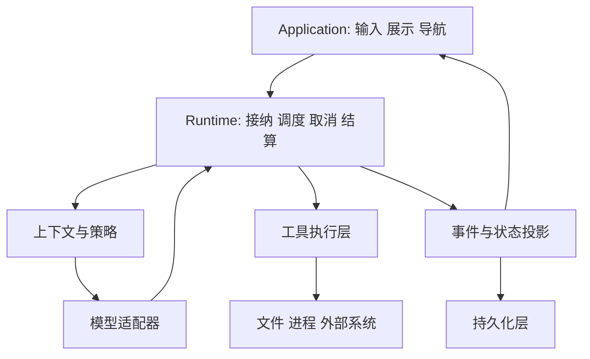

# 第 3 章　运行时架构与领域模型

[教材目录](../README.md) · 上一章：[模型接口](02-model-interface.md) · 下一章：[Agent 循环](04-agent-loop.md)

**先修要求：**前两章；理解异步函数与对象生命周期。**学习目标：**能够拆分 model、harness、runtime 与 application 的责任；正确区分 session、turn、step、attempt、event 和 artifact；沿控制流与数据流阅读陌生项目。

## 3.1 为什么不能只有一个 `chat()` 函数

最初的原型可以用一个函数组装 prompt、调用模型并返回文本。CSV 修复任务很快会提出更多要求：用户中途取消；读取文件后修改权限变化；工具执行成功但网络断开；界面重连后希望知道当前是否仍在运行。若把所有状态塞进对话字符串，系统将难以回答“哪些操作已经发生”和“现在谁在负责继续执行”。

因此要把职责分开。**Model** 是按输入产生内容的推断服务或组件；**Harness** 是把模型接入工具、上下文、权限、存储和任务控制的系统安排；**Runtime** 是这些安排在进程中实际运转的执行机制；**Application** 是面向用户的产品层，包括交互方式、任务入口和结果呈现。这套划分是教学坐标，不是要求仓库必须出现四个同名目录。现实项目的 runtime 往往属于 harness，二者边界也可能重叠。

一个有用的责任分配原则是：界面可以展示“正在测试”，但测试是否真的开始应由执行事件决定；模型可以提出“停止”，但 runtime 需要先结算在途工作；数据库保存历史，不应仅凭历史里最后一句“完成”推断进程当前仍然空闲。



箭头表达依赖和数据传递，不表示所有项目都采用同一线程模型，也不保证所有事件都先落盘再显示。

## 3.2 六个容易混淆的名词

| 教学名词 | 本书含义 | CSV 修复例子 |
| --- | --- | --- |
| Session | 长于一次交互的身份与历史容器 | 用户在同一个会话里继续要求支持负金额 |
| Turn | 一批已接纳输入驱动的交互阶段 | “修复并验证”对应的一轮活动 |
| Step | 一次逻辑模型推进及其相关结果处理 | 请求读取文件，再处理读取结果 |
| Attempt | 为完成某个逻辑推进而进行的一次尝试 | 首次请求在产出前超时，随后重试 |
| Event | 系统接受或观察到的一件有类型的事实 | 工具调用开始、工具结果、轮次结束 |
| Artifact | 可被引用、交付或后续使用的产物 | 补丁、测试报告、修改后的 CSV 程序 |

这是跨项目教学词汇，实际源码未必一一对应。某些项目把一次模型请求叫 turn，另一些项目用 turn 包含多次请求；有些项目把 attempt 明确建模，有些使用重试状态机。读源码时应先找生命周期边界，再翻译名称。

尤其不能把用户任务强行等同于 turn。一个任务可能跨多次用户补充；一轮活动也可能消化运行期间送入的新输入。Session 仍然存在，不说明里面有正在执行的工作；页面显示某个 session，也不说明该浏览器持有执行权。

## 3.3 身份让失败能够被解释

可以为 CSV 任务设计一组**教学追踪标识**：会话 `S7`、轮次 `T2`、步骤 `P3`、尝试 `A1`、工具调用 `C9`。模型请求在产出前失败后，第二次尝试是 `A2`，逻辑步骤仍是 `P3`。若 `A1` 已经启动工具，则能否再次执行必须另外判断，不能仅因请求重试就把文件修改再做一遍。

事件则回答发生了什么：

```text
T2 accepted
P3 started
A1 request failed before output
A2 tool call C9 accepted
C9 returned: exit_code=0, output="3 tests passed"
P3 settled
T2 ended: completed
artifact: patch + verification reference C9
```

这不是三个项目的真实日志格式，也不是已经运行的实验。它展示的是关系：多个 attempt 可以服务于同一个 step；工具结果关联 call；产物引用验证证据；turn 的结束原因独立于 session 的存在。

标识设计的价值在故障后尤为明显。没有调用 ID，只能看到两次“运行测试”；有调用 ID，才可能区分一次执行的重复显示与两次独立执行。ID 本身不实现幂等性，还需要工具和存储按它处理重复，但它提供了表达问题的基础。

## 3.4 控制流与数据流要分开画

**控制流**描述下一步由谁触发：用户提交输入，执行协调器启动 runner，runner 请求模型，模型输出工具调用，工具完成后 runner 继续。取消、超时和预算判断也是控制流。

**数据流**描述信息如何变换：输入成为事件，事件被投影成对话历史，历史被适配为模型请求，响应被解释为内容和调用，工具结果再成为事件。两条流经常穿过相同函数，但关注点不同。

不要假定“历史”“模型上下文”“UI 文本”和“存储日志”是同一个数组。历史可能保存完整事件，而模型只收到筛选后的消息；界面可能临时展示尚未结算的增量；存储可能稍后批量写入。把它们分开，可以让 UI 更新不改变模型语义，让上下文压缩不抹掉审计证据。

这带来一个必须明确的词：**提交**。内存接受事件、数据库事务提交、文件写入完成和刷新到存储的检查点，是不同层级的承诺。可靠架构应给每层命名，不能让一个 `save()` 返回值同时模糊代表所有阶段。

## 3.5 三个项目怎样落地这些边界

### Codex：长生命周期 Session 与逐步捕获的上下文

`Session` 持有 thread ID、事件发送端、状态锁、当前 active turn、输入队列和 SessionServices。`TurnContext` 则持有这一轮的 ID、配置和扩展状态，并明确提示模型请求使用 `StepContext` 的设置快照；后续步骤的设置可以不同于初始设置。由此可以看出，不能把“会话当前设置”简单视为每个在途工具的唯一配置来源。见 [`Session`，59–100 行](https://github.com/openai/codex/blob/a9b0815167c27ab13719dd12d13b63e02b70d221/codex-rs/core/src/session/session.rs#L59-L100) 与 [`TurnContext`，321–345 行](https://github.com/openai/codex/blob/a9b0815167c27ab13719dd12d13b63e02b70d221/codex-rs/core/src/session/turn_context.rs#L321-L345)。

CSV 任务进行时若设置发生变化，架构问题不只是“读取最新配置”，还包括“已发出的请求应继续使用哪一版工具和环境”。把步骤上下文明确建模，使这个问题有了稳定的归属。这里是对结构的教学解释，不是对所有配置更新路径的完整验证。

### OpenCode：Execution、Runner、Step 的责任拆分

`SessionExecution` 提供 `resume`、`wake`、`interrupt` 和 `awaitIdle`，负责进程内执行所有权与生命周期；其 `drain` 调用选定实例中的 `SessionRunner`，并处理 `Complete`、`Moved` 与 `Reloaded`。Runner 的接口明确是从已记录的 Session 历史推进本地 continuation；`runStep` 管逻辑步骤政策，再调用 `SessionStep.attempt` 处理一次尝试。见 [`SessionExecution` 接口，17–46 行](https://github.com/anomalyco/opencode/blob/60a212c0769acd96b446acbadeb790486830f91d/packages/core/src/session/execution.ts#L17-L46)、[`drain`，87–109 行](https://github.com/anomalyco/opencode/blob/60a212c0769acd96b446acbadeb790486830f91d/packages/core/src/session/execution.ts#L87-L109)、[`SessionRunner`，21–39 行](https://github.com/anomalyco/opencode/blob/60a212c0769acd96b446acbadeb790486830f91d/packages/core/src/session/runner/index.ts#L21-L39) 与 [`runStep`，205–245 行](https://github.com/anomalyco/opencode/blob/60a212c0769acd96b446acbadeb790486830f91d/packages/core/src/session/runner/llm.ts#L205-L245)。

更细的一点是 `interrupt` 接受中断后，清理可能仍异步进行；要等待停止结算，调用方应使用相应等待语义。于是“取消请求已接收”和“所有在途工作已结算”是不同状态。界面若把前者立即当成后者，就可能在旧执行清理时启动冲突操作。此处依据接口契约解释边界，未进行并发故障实验。

### DeepSeek Harness：事件日志、投影与持久化检查点

`Session` 拥有事件日志以及 `SurfaceManager` 管理的有序 surface。`append` 为事件生成连续序号，对 JSON 数据做快照、冻结与验证后提交；类型注释明确指出热路径不等待 I/O，持久化插件异步缓冲。`SessionStore.flush` 才等待参与的持久化监听器全部结算，并在失败时抛出异常。见 [`Session`，522–540 行](https://github.com/deepseek-ai/deepseek-harness/blob/d743267388641bc76f17c45ce8b4c231aed1d32c/packages/core/session/src/index.ts#L522-L540)、[`append` 的边界，761–782 行](https://github.com/deepseek-ai/deepseek-harness/blob/d743267388641bc76f17c45ce8b4c231aed1d32c/packages/core/session/src/index.ts#L761-L782)、[`append` 实现，798–826 行](https://github.com/deepseek-ai/deepseek-harness/blob/d743267388641bc76f17c45ce8b4c231aed1d32c/packages/core/session/src/index.ts#L798-L826) 与 [`flush`，1305–1334 行](https://github.com/deepseek-ai/deepseek-harness/blob/d743267388641bc76f17c45ce8b4c231aed1d32c/packages/core/session/src/index.ts#L1305-L1334)。

因此，在这个固定版本中，看到 `append('tool/result', ...)` 不能直接断言对应记录已经到达磁盘；还要继续追踪已安装的持久化插件和 checkpoint 政策。反过来，`flush` 返回也要看是否有监听器参与。把“可观察的进程内事实”和“可恢复的存储事实”区分开，是阅读本项目的重要前提。

## 3.6 架构取舍与失败推演

把职责拆细有利于替换模型、支持多界面与定位故障，但也增加跨层契约。一个简单原型不必立刻采用服务注册表、事件总线和完整数据库；至少应先分开模型请求、工具执行、状态存储和界面呈现，避免副作用藏在文本格式化函数里。

假设 CSV 补丁已写入文件，但客户端没收到最后一条消息。应用层不应只因断线就从头应用补丁；runtime 应检查已结算动作与产物。若事件也未持久化，恢复会更加困难，需要检查环境事实。完整恢复策略在后续章节展开，本章先建立“文件状态、事件状态、显示状态可能不同步”的心智模型。

建议的架构不变量是：一个 session 的活动执行有明确所有者；步骤使用可识别的配置视图；每个副作用有可关联的调用记录；每种“已完成”状态写清承诺范围。这些是设计目标，并不是仅凭类型声明就能证明的运行保证。

## 3.7 练习与参考思路

1. 用户在同一聊天中连续提出两个独立问题，需要新建两个 session 吗？<br>
   **参考思路：**不必。session 是产品与历史边界，两个输入通常可对应不同 turn；具体接纳方式由产品语义决定。
2. 同一个模型步骤在响应输出前超时，重试成功。应计为两个逻辑步骤吗？<br>
   **参考思路：**教学模型中是一个 step、两个 attempt。实际项目可能不同，应寻找计数递增的位置和结果结算边界。
3. DSH `append` 返回后进程退出，能否仅凭该返回值证明事件可恢复？<br>
   **参考思路：**不能。必须检查持久化监听器、flush/checkpoint 是否完成，以及存储后端的承诺。
4. **设计题：**为“补丁已应用，网络随后断开”画出文件、事件和 UI 三种状态，并给出恢复时的读取顺序。<br>
   **参考思路：**先确认执行所有权和已有持久记录，再核对文件实际差异，最后重建界面；不要直接按 UI 缺失重复写入。若证据不足，应明确不确定性并使用可重复检查。

可进一步对照 [Codex 会话](../../agent-infra-study/codex/02-context-session.md)、[OpenCode 编排](../../agent-infra-study/opencode/06-task-orchestration.md)、[DSH 持久化](../../agent-infra-study/dsh/07-persistence-reliability.md)。本章只做固定源码阅读与架构推演，没有运行上游恢复测试。
