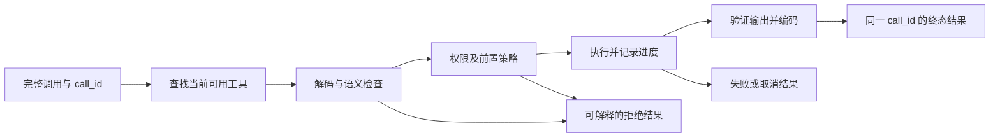

# 第 6 章：工具契约——从模型提议到可追踪的执行

[教材目录](../README.md)

**先修知识：**JSON、类型检查和异步函数。**学习目标：**设计输入与输出契约，解释调用身份的用途，区分参数有效、权限允许与执行成功，并正确处理取消和已经发生的副作用。

## 6.1 工具不是一个函数名，而是一条协议

模型输出 `edit_file({...})` 时，产生的是执行提议。宿主还必须回答：本次请求是否暴露该工具？参数是否完整并符合类型？路径和操作是否在允许范围内？要用哪个执行器？结果如何与原调用配对？进程中断时谁负责收尾？这些问题共同组成**工具契约**。

以 CSV 修复为例，一个教学用编辑工具可接受 `path`、`old_text`、`new_text`、`expected_version`，返回 `changed`、`new_version` 和 `diff`。字符串类型只证明参数是字符串，不证明路径存在、旧文本唯一、版本仍然相同，更不证明改动符合用户需求。至少有四层校验：传输层保证完整消息；结构层保证字段与类型；语义层保证“旧文本非空、匹配唯一”；政策层决定当前调用能否修改该文件。把所有失败都返回为“参数错误”，会让模型在无权限时不断改参数重试。

工具说明帮助模型选择动作；schema 约束表达；运行时校验阻止非法输入；业务执行器维护真实资源的不变量。即使 Provider 支持严格 schema，宿主仍要检查不可信输入，因为同一工具还可能被代码模式、插件或外部客户端调用。

## 6.2 调用身份、结果身份与执行生命周期

`call_id` 表示一次具体调用，不是工具的名称，也不是任务编号。两个并行的 `read_file` 需要不同调用身份；一次调用的成功或失败结果必须回到它自己的身份。嵌套工具还可保存 root/parent 关系：外层运行程序，内层调用读取和编辑，界面可以聚合展示，审计仍能还原每个动作。



图中是教学上的责任分解，不规定所有项目阶段顺序完全相同。例如策略可能需要先读取原始参数，或允许一个修复 hook 重写输入；此时重写后的输入仍须经过适用的执行校验。重要不变量是：身份不因重写而漂移，执行开始与未开始可区分，终态不会因界面渲染失败被伪装成尚在运行。

输出也有三种用途：供程序读取的结构化值、给模型的简短内容、给界面的展示元数据。它们不应互相代替。文件编辑的 `changed: true` 与漂亮的差异卡片不同；测试工具的退出码、测试数量、失败条目应有稳定结构，而不是让下一轮模型从一句“看起来不错”里猜。

下面是教学用调用信封，标识和版本值均为占位符，不是任何项目的真实 API。调用 ID 配对结果，文件版本表达写入的前置条件，两者解决不同问题：

```json
{
  "call_id": "edit_7",
  "tool": "edit_file",
  "arguments": {
    "path": "totals.py",
    "old_text": "total += price",
    "new_text": "total += price * quantity",
    "expected_version": "version_before"
  }
}
```

执行器应先确认当前文件仍是 `version_before`，再完成唯一匹配替换，返回同一 `edit_7` 及新版本。若版本不同，即使旧文本仍然存在，也应按约定返回冲突，由调用者重新读取。若输出包含差异卡片，卡片应从实际修改结果生成；不应把请求中希望发生的修改当成已经发生的修改。

## 6.3 三个项目的契约实现

**Codex：带身份的 payload 分派。**`ToolRouter::build_tool_call` 分别处理函数调用、客户端工具搜索和自由格式自定义调用，保留 `call_id`；分派时构造包含 session、step context、取消令牌和 payload 的 `ToolInvocation`。因此“所有工具参数都是 JSON 对象”不是这里的正确抽象，`apply_patch` 就走自定义文本形式。[调用构造：257–307 行](https://github.com/openai/codex/blob/a9b0815167c27ab13719dd12d13b63e02b70d221/codex-rs/core/src/tools/router.rs#L257-L307)，[执行上下文：359–392 行](https://github.com/openai/codex/blob/a9b0815167c27ab13719dd12d13b63e02b70d221/codex-rs/core/src/tools/router.rs#L359-L392)

registry 先拒绝不匹配的 payload，再运行前置 hook；具体 handler 继续承担自己的解析。例如 `exec_command` 根据执行环境路径约定解析参数，并检查 TTY 功能是否启用。`AnyToolResult::into_response` 通过同一 `call_id` 构造模型输入结果。读这几处时，应沿“路由—handler—结果编码”追踪，而不是只看 schema 生成函数。[registry：683–725 行](https://github.com/openai/codex/blob/a9b0815167c27ab13719dd12d13b63e02b70d221/codex-rs/core/src/tools/registry.rs#L683-L725)，[参数与 TTY：231–248 行](https://github.com/openai/codex/blob/a9b0815167c27ab13719dd12d13b63e02b70d221/codex-rs/core/src/tools/handlers/unified_exec/exec_command.rs#L231-L248)，[结果编码：214–229 行](https://github.com/openai/codex/blob/a9b0815167c27ab13719dd12d13b63e02b70d221/codex-rs/core/src/tools/registry.rs#L214-L229)

**OpenCode：工具定义与执行 codec。**`tool.ts` 从调用建立 `Tool.Context`，保留 session、agent、message 与 call 身份，并根据本次请求的定义和当前直接工具集合解析名称；工具存在于注册表，并不意味着在每次请求中都可调用。[请求级分派：263–283 行](https://github.com/anomalyco/opencode/blob/60a212c0769acd96b446acbadeb790486830f91d/packages/core/src/tool.ts#L263-L283)

`tool/runtime.ts` 先 `decodeInput`，再执行，统一外来插件的 typed failure 为 `Tool.Error`，之后处理声明的输出和内容。这里有一个值得细读的边界：输入可来自 Standard Schema、Effect Schema 或原始 JSON Schema；若原始 JSON Schema 不能生成 codec，当前 `validateInput` 会原样接受值。输出使用 Effect/Standard Schema 时按其规则编码或验证；原始 JSON Schema 的分支只保证值是 JSON。因此不能笼统声称“所有 schema 在本地完全强校验”。[执行与输入：29–85 行](https://github.com/anomalyco/opencode/blob/60a212c0769acd96b446acbadeb790486830f91d/packages/core/src/tool/runtime.ts#L29-L85)，[输出：110–132 行](https://github.com/anomalyco/opencode/blob/60a212c0769acd96b446acbadeb790486830f91d/packages/core/src/tool/runtime.ts#L110-L132)

`SessionStep` 另负责执行生命周期：先完成 `Tool.Called` 事件发布，再启动本地执行 fiber；工具返回后做截断与结果发布，类型化工具错误转成失败事件。声明、调用和生命周期分属不同模块，是阅读该版本源码时必须跨越的边界。[SessionStep：107–141 行](https://github.com/anomalyco/opencode/blob/60a212c0769acd96b446acbadeb790486830f91d/packages/core/src/session/runner/step.ts#L107-L141)

**DeepSeek Harness：规范值、投影与分阶段调度。**`defineTool` 从参数描述构建 schema，其执行包装器在调用用户函数前检验参数；回放展示则允许旧参数不匹配时降级为普通视图，避免历史记录仅因 schema 演进而无法显示。[defineTool：574–615 行](https://github.com/deepseek-ai/deepseek-harness/blob/d743267388641bc76f17c45ce8b4c231aed1d32c/packages/core/tools/src/schema.ts#L574-L615)

registry 创建每次执行的 token、`callId` 与 `rootCallId`，对参数做可无损 JSON 化快照并深冻结；成功返回值也会先快照、依据输出 schema 校验、冻结，再生成模型内容与展示元数据。这个顺序避免执行后某个共享对象被修改，导致审计记录和模型看到不同事实。[执行快照：1397–1458 行](https://github.com/deepseek-ai/deepseek-harness/blob/d743267388641bc76f17c45ce8b4c231aed1d32c/packages/core/tools/src/index.ts#L1397-L1458)，[成功结果：1837–1867 行](https://github.com/deepseek-ai/deepseek-harness/blob/d743267388641bc76f17c45ce8b4c231aed1d32c/packages/core/tools/src/index.ts#L1837-L1867)

其 pre-execute 阶段可允许、拒绝、取消或请求批准，随后检查 guard 和取消状态；实际工具体执行后，还要经过结果规范化与后处理。一个阶段允许调用，不等于后面的单调约束也允许。[准备阶段：1499–1543 行](https://github.com/deepseek-ai/deepseek-harness/blob/d743267388641bc76f17c45ce8b4c231aed1d32c/packages/core/tools/src/index.ts#L1499-L1543)

## 6.4 取消不是撤销，错误也不等于没有副作用

考虑 CSV 文件已写入成功，但结果编码失败：模型收到错误，却不能安全地假定旧文件仍在。或发出远端请求后连接断开：服务器可能已经执行。应分别记录“尚未分派”“执行中”“已知完成”“结果未知”，必要时先读回资源确认再决定重试。只有操作及其执行系统确实支持幂等键或事务，才可以据此提供相应保证。

DSH 将执行前取消与工具体被调用后的取消区分成两个结果；它将原始调用者信号重新合并进包装器信号，并等待已经开始的工具 promise 收敛，而不是仅停止等待就宣布调用结束。该设计对合作式取消有效，但不意味着任意不响应取消的工具都能立即停下，更不意味着自动回滚。[dispatchToolBody：1555–1597 行](https://github.com/deepseek-ai/deepseek-harness/blob/d743267388641bc76f17c45ce8b4c231aed1d32c/packages/core/tools/src/index.ts#L1555-L1597)，[两类取消结果：1963–1987 行](https://github.com/deepseek-ai/deepseek-harness/blob/d743267388641bc76f17c45ce8b4c231aed1d32c/packages/core/tools/src/index.ts#L1963-L1987)

Codex 的 registry 则明确区分 PostToolUse 对结果的阻止与已经完成的工具执行：后置 hook 可以拒绝模型使用该结果，但不能据此宣称文件写入没有发生。这是审计和重试设计中十分重要的事实。[后置结果处理：846–880 行](https://github.com/openai/codex/blob/a9b0815167c27ab13719dd12d13b63e02b70d221/codex-rs/core/src/tools/registry.rs#L846-L880)

本例的稳健流程是：读取 CSV 汇总模块与版本；将只累加 `Decimal(price)` 的旧代码，局部改为累加 `Decimal(price) * quantity`；若调用异常，先读取实际文件并比对版本与目标文本；确认后运行测试。`pen,3.50,2` 与 `book,12.00,3` 应从错误的 `15.50` 变为 `43.00`。切勿因为结果卡片没有出现就重复追加代码。对于发送邮件、发布制品等外部副作用，应该事先设计查重键和查询路径，不能把一次新的 `call_id` 误当成外部系统的幂等保证。

## 6.5 练习与参考解法

1. **接口题：**给 `run_tests` 设计最小输出。**参考：**包含运行状态、退出码或终止原因、测试发现数、通过/失败数、完整日志引用、执行的代码版本。尚在运行时返回进程身份，不能编造退出码。
2. **故障题：**编辑成功后输出序列化失败，重试前应该做什么？**参考：**读取文件或查询操作记录，确认目标效果是否已发生；只有确认未发生或具备真实幂等语义才重试。
3. **源码题：**OpenCode 中“有 output schema”是否必然意味着本地完整校验？**参考：**否。必须检查 schema 表示与 `encodeOutput` 分支；原始 JSON Schema 分支在这里检查 JSON 可表示性。
4. **设计题：**实现一个允许 hook 改写参数的工具管线。**参考：**保存原始与最终参数摘要及同一调用身份；每次改写后重新执行结构和语义校验；执行前按最终动作授权；结果引用最终参数；后置拒绝记录副作用已发生的可能性。

本章机制来自所链接版本的源码阅读；未运行上游测试。练习中的工具及故障注入均为待实现实验。

按项目复习工具链可继续阅读原笔记：[Codex](../../agent-infra-study/codex/03-tools-sandbox.md)、[OpenCode](../../agent-infra-study/opencode/03-tools-sandbox.md)、[DSH](../../agent-infra-study/dsh/03-tools-sandbox.md)。
