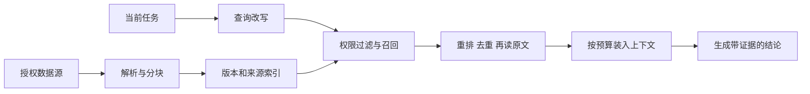

# 第 10 章：检索与记忆——让经验可找回、可质疑、可遗忘

[教材目录](../README.md)

**先修知识：**第 9 章的上下文与来源模型。**学习目标：**区分检索、会话持久化、摘要和长期记忆；设计 RAG 与记忆生命周期；准确辨认三个项目的原生实现和需要扩展的部分。

## 10.1 先把四种“记住”分开

工程中经常把以下四件事都称作 memory，容易让功能评估失真。

| 对象 | 解决的问题 | 常见载体 | 本身不保证什么 |
| --- | --- | --- | --- |
| 工作记忆 | 本步骤需要什么 | 当前模型消息、任务状态 | 跨会话保留 |
| 事件历史 | 过去发生了什么 | JSONL、数据库事件表 | 自动找到最相关经验 |
| 情景摘要 | 怎样接着某次任务做 | 会话 checkpoint、运行总结 | 内容完全无损、永远有效 |
| 长期记忆 | 哪些经验值得未来复用 | 有来源的事实、偏好、流程笔记 | 事实现在仍成立 |

**检索**是从某个集合找材料的操作，可以作用于源代码、手册、历史或长期记忆。**RAG（检索增强生成）**是先取回证据，再让模型结合证据生成回答或行动的流程。它不要求向量数据库：精确符号查找、关键词检索和文件读取同样能形成 RAG。向量相似度表示语义接近，不代表事实真实，也不代表当前用户有权查看。

把事件日志搬到数据库只完成了保存。要成为可用的长期记忆，还需要决定写什么、何时召回、如何处理冲突、何时更新和删除。模型参数中已有的知识又是另一层；本章讨论的是宿主管理的外部信息，不把对话保存称作“模型学会了”。

## 10.2 从文档到回答的检索管线

教学上的完整管线是：



分块应保留可解释的边界。代码可按函数、类型或调用片段分块；说明书可按小节分块。单纯每 500 字切一次，可能把金额单位与数值拆开。每块至少携带文档标识、版本、位置与访问范围。索引是派生物，原文才是核对依据；文件改了但索引没更新，是常见的“答案看起来正确却引用旧代码”原因。

关键词适合 `sum_amount`、错误码和精确命令；向量适合“哪里把金额变成字符串”这类表达差异；混合召回把两类候选合并，再按当前任务重排。重排只改变顺序，不创造证据。最终读取周边源码，确认调用关系和限定条件，才允许把命中片段写成工程结论。

评价检索也要分层：`Recall@k` 检查关键证据是否进入前 k 个候选；上下文精度检查送给模型的材料有多少相关内容；答案可归因性检查结论能否由所引证据支持；任务测试检查补丁是否真的修好。检索命中率高，仍可能因权限、陈旧材料或生成阶段误读而失败。这些指标是本章提出的评估框架，不是上游已执行的基准。

## 10.3 记忆的写入、召回、修订与遗忘

可以采用这样的教学记录：

```text
Memory = {claim, kind, scope, source_refs, observed_at,
          last_verified_at, status, supersedes, access_policy}
```

写入时先判断“以后是否有用”，再判断“是否有证据”。用户说“这次不用新依赖”不等于永久偏好；一次测试通过也不等于该模块永不出错。把推测写为事实，会在未来检索中不断强化误判。长日志可以留下摘要，但应保留原始消息或文件位置，使摘要可被质疑。

召回遵循任务范围与权限，而不是把所有历史一股脑加进 prompt。更新时保留来源链：新规则取代旧规则，旧记录标为 superseded；观察矛盾时先列出冲突，不能简单按“最近被检索”判真。遗忘包括过期淘汰、用户要求删除和来源撤销；删除原文之后，还要处理摘要、索引、缓存和派生事实，否则删掉一份文件不等于消除了记忆。

检索权限是读权限，保存经验是写权限，二者必须分开。一个工具能访问工单，不表示能把其中全部细节永久保存到个人记忆。若跨项目复用，应显式设计命名空间、最少必要字段和来源访问检查。以上是系统设计要求，不能据此假定三个项目已经实现统一的多租户策略。

## 10.4 三个项目的真实边界

**Codex 有专门的长期记忆管线，且受功能与会话条件控制。**`start_memories_startup_task` 排除 ephemeral、功能未开启及非根 Agent 会话，依次调度 phase 1 和 phase 2，并处理状态数据库和额度条件。这说明它不能被描述成“只有聊天记录”，也不能描述成“每个会话默认自动学习”。[`start.rs:20–38`](https://github.com/openai/codex/blob/a9b0815167c27ab13719dd12d13b63e02b70d221/codex-rs/memories/write/src/start.rs#L20-L38)，[`start.rs:59–91`](https://github.com/openai/codex/blob/a9b0815167c27ab13719dd12d13b63e02b70d221/codex-rs/memories/write/src/start.rs#L59-L91)

Phase 1 领取符合来源、年龄、空闲时间限制的 rollout 作业，并可按未使用天数淘汰旧的 stage-1 输出。[`phase1.rs:96–145`](https://github.com/openai/codex/blob/a9b0815167c27ab13719dd12d13b63e02b70d221/codex-rs/memories/write/src/phase1.rs#L96-L145) Phase 2 获取全局锁、同步输入并根据工作区差异决定整合。[`phase2.rs:60–105`](https://github.com/openai/codex/blob/a9b0815167c27ab13719dd12d13b63e02b70d221/codex-rs/memories/write/src/phase2.rs#L60-L105)，[`phase2.rs:109–151`](https://github.com/openai/codex/blob/a9b0815167c27ab13719dd12d13b63e02b70d221/codex-rs/memories/write/src/phase2.rs#L109-L151) 后者把自身设为 ephemeral，关闭记忆生成和使用，避免整合结果反复喂回自身；托管权限模式下限制为记忆根目录写入且不联网，而显式 Disabled/External 权限模式有另行保留分支。因此“整合 Agent 总是同一种沙箱”也是错误概括。[`phase2.rs:299–340`](https://github.com/openai/codex/blob/a9b0815167c27ab13719dd12d13b63e02b70d221/codex-rs/memories/write/src/phase2.rs#L299-L340)

读取端也单独受控：`MemoriesExtensionConfig` 同时检查功能和 `use_memories`，专用工具还需要 `dedicated_tools`。[`extension.rs:45–52`](https://github.com/openai/codex/blob/a9b0815167c27ab13719dd12d13b63e02b70d221/codex-rs/ext/memories/src/extension.rs#L45-L52)，[`extension.rs:135–158`](https://github.com/openai/codex/blob/a9b0815167c27ab13719dd12d13b63e02b70d221/codex-rs/ext/memories/src/extension.rs#L135-L158) 本次精读的本地搜索按行匹配多个查询，返回路径、行号与分页；这是真实检索，不能擅自叫作向量语义搜索。[`local/search.rs:67–88`](https://github.com/openai/codex/blob/a9b0815167c27ab13719dd12d13b63e02b70d221/codex-rs/ext/memories/src/local/search.rs#L67-L88)，[`local/search.rs:130–159`](https://github.com/openai/codex/blob/a9b0815167c27ab13719dd12d13b63e02b70d221/codex-rs/ext/memories/src/local/search.rs#L130-L159)

**OpenCode：明确定位的是检索工具、当前指令与会话 checkpoint。**`grep` 在路径授权与权限检查后调用 ripgrep，并把路径、行号、预览交给模型；上下文加载器组合 skills、references、MCP、指令与当前历史。这足以构成代码检索增强的工作流。[`grep.ts:43–60`](https://github.com/anomalyco/opencode/blob/60a212c0769acd96b446acbadeb790486830f91d/packages/core/src/tool/plugin/grep.ts#L43-L60)，[`grep.ts:82–120`](https://github.com/anomalyco/opencode/blob/60a212c0769acd96b446acbadeb790486830f91d/packages/core/src/tool/plugin/grep.ts#L82-L120)，[`context.ts:130–179`](https://github.com/anomalyco/opencode/blob/60a212c0769acd96b446acbadeb790486830f91d/packages/core/src/session/context.ts#L130-L179)

在本章精读的 `session/context`、`session/compaction`、`session/instructions` 和 grep 实现中，没有定位到与 Codex phase1/phase2 等价的跨会话经验抽取管线；要加此能力，应另定义索引、记忆存储、更新/删除策略与调用入口，不能把 session 恢复直接等同为该能力。另一个易误判的文件 `environment/memory.ts` 实际是以 `Map` 保存文件节点的内存文件系统驱动，不是 Agent 长期记忆。[`makeMemoryDriver:7–18`](https://github.com/anomalyco/opencode/blob/60a212c0769acd96b446acbadeb790486830f91d/packages/core/src/environment/memory.ts#L7-L18)

**DeepSeek Harness：持久化、历史全文检索、经验整合是不同层。**会话持久化接口定义追加日志，`append` 是 best-effort 持久化，`flush` 才是持久性屏障；这一层处理可靠保存。[`SessionPersistence:117–135`](https://github.com/deepseek-ai/deepseek-harness/blob/d743267388641bc76f17c45ce8b4c231aed1d32c/packages/session/session-persistence/src/index.ts#L117-L135)

仓库还提供 session-query 的 SQLite FTS5 派生索引，文档关联 `session_id`、`seq`、类型和时间；实验性 `session-search` profile 挂载这个服务及工具。因此不能简单写成“DSH 没有历史检索”。工具的跨会话授权会检查调用方与目标会话的 cwd；这是一条具体的工作区边界，不宜扩大解释为企业身份体系。[`schema.ts:112–137`](https://github.com/deepseek-ai/deepseek-harness/blob/d743267388641bc76f17c45ce8b4c231aed1d32c/packages/session-query/session-query-sqlite/src/schema.ts#L112-L137)，[`cordis.patch.yml:1–14`](https://github.com/deepseek-ai/deepseek-harness/blob/d743267388641bc76f17c45ce8b4c231aed1d32c/packages/experimental/session-search/cordis.patch.yml#L1-L14)，[`authorizeTarget:75–99`](https://github.com/deepseek-ai/deepseek-harness/blob/d743267388641bc76f17c45ce8b4c231aed1d32c/packages/experimental/tool-session-query/src/workspace-access.ts#L75-L99)

全文历史检索已经超出单纯保存，但在这些模块中并未定位到“抽取用户偏好、冲突整合、长期事实淘汰”的完整记忆管线；那部分仍应作为扩展设计讲授。FTS5 也不是 embedding 检索。

## 10.5 贯穿案例：不要把一次修复变成永久真理

CSV 案例的查询可从 `price`、`quantity` 与 `total` 开始，命中汇总函数后读取上下文，发现程序仅加单价而漏乘数量。pen 的 3.50×2 加上 book 的 12.00×3 应为 43.00，错误结果却是 15.50。检索历史时找到“旧版本金额类型曾有问题”，必须先核对当前公式，不能把历史修复机械套用到此次数量缺陷。

在 Decimal 金额计算中补上数量乘法并验证后，适合保存的经验是“此项目金额路径要求十进制定点；测试入口为某命令”，附项目、源码版本、用户规则和实际测试记录。适合保存到会话状态的是“本次补丁已改、测试通过、尚未提交”。不适合写成长期事实的是“所有 CSV 都应用 Decimal”或“该测试永远通过”。下一次召回先用经验定位文件，再验证版本；记忆缩短的是寻找路径，不替代当前证据。

## 10.6 练习与参考答案

1. **分类题：**JSONL 恢复、FTS5 搜索、压缩摘要、根据多次任务提炼项目规则分别属于什么？

   **参考答案：**历史持久化、检索、情景摘要、长期记忆整合。它们可以连接，但互不等价。

2. **诊断题：**某项目有 `memory.ts`，为何不能据此宣布支持长期记忆？

   **参考答案：**必须检查对象与生命周期。OpenCode 所引文件存的是虚拟文件节点；“memory”可能只表示存储介质在进程内。

3. **设计题：**源规则被撤回后，怎样防止旧摘要继续生效？

   **参考答案：**维护 source→派生记录关系，撤回时标记或移除依赖记录、刷新索引/缓存；召回时检查状态和权限。只有删除源文件而保留无来源摘要，无法可靠传播撤销。

4. **评估题（建议实验，未运行）：**建立 20 个 CSV 修复问题，比较关键词与混合检索。除最终成功率外记录什么？

   **参考答案：**关键证据 Recall@k、装入上下文的相关比例、版本正确率、来源可追溯率、拒绝越权比例、token 与时间成本。固定代码版本和问题集，避免把模型变化误算成检索收益。

本章的原生能力指固定源码中的实现与明确开关，未宣称任何安装环境已启用这些功能，亦未运行模型抽取或检索基准。
