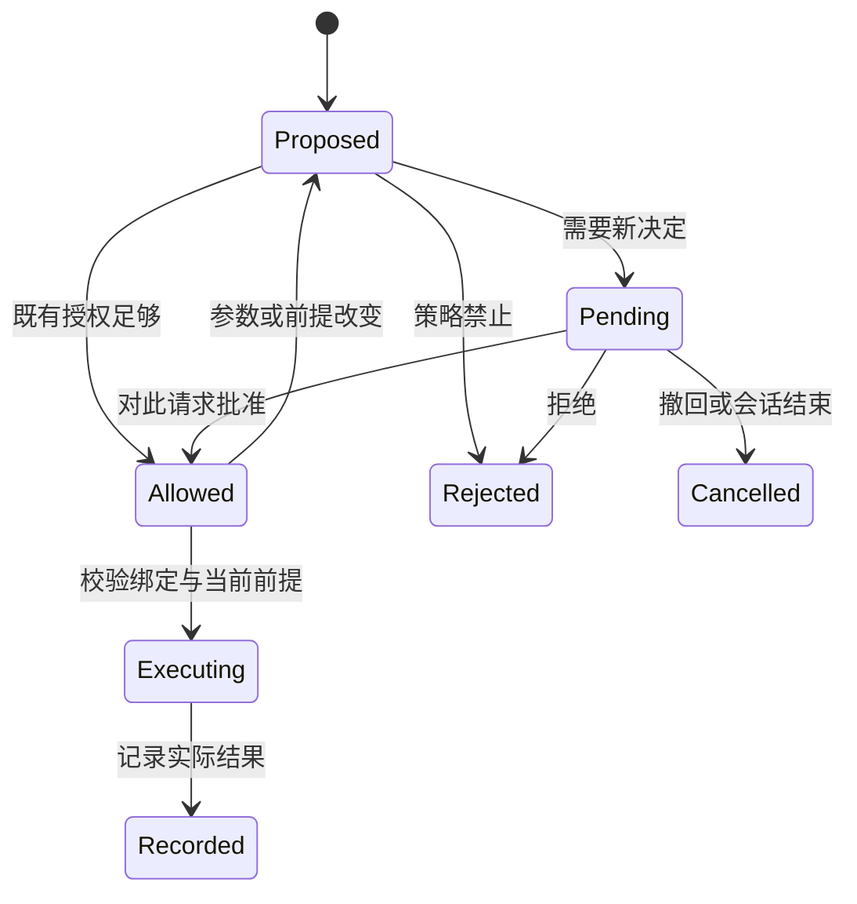

# 第 17 章：权限与人在回路——把“想做”变成可核验的执行许可

[教材目录](../README.md)

**先修知识：** 工具调用、会话状态、异步取消。**学习目标：** 区分计划、授权和执行；设计与具体请求绑定的审批；解释会话授权的作用域；识别审批等待引入的竞争条件。全文的机制模型是教学抽象，三个项目的具体实现均以固定提交源码为准。

## 17.1 为什么一个“同意”按钮不够

用户说“修复 CSV 合计错误并验证”，表达了任务目标，也通常授予了完成任务所需的本地修改与测试权限。模型随后产生“运行测试”的计划，这只是一种未来意图。工具请求才把意图具体化为进程、参数、目录和副作用；宿主根据既有授权、部署策略及实际请求决定是否允许执行。若每个低风险读取都询问，用户会机械确认；若把一次任务授权解释成任意操作许可，又会越过任务边界。人在回路的工程目标是把人的判断放在有意义、尚未授权的决策点上。

可以把一次动作表示成：

```text
R = (actor, session, tool, target, arguments, environment,
     requested_permissions, expected_effects)
Decision = policy(R, current_state) ∈ {allow, ask, deny}
```

`allow` 是策略已足够授权，`ask` 表示需要一个新的决定，`deny` 表示当前规则禁止。三者不能简化为“弹窗/不弹窗”：无人值守模式可能是不询问并拒绝需要审批的动作，也可能允许原有沙箱内动作继续。计划文本不能代替这个判断，模型写出“用户已批准”也不能制造许可。

审批系统至少有三种主体：提出动作的 Agent、作出决定的用户或受配置约束的审查器、落实决定的执行器。即使三个组件恰好在同一进程，职责也应分开。否则生成请求的组件能够自行修改审批结果，整个控制只剩一段提示词。

## 17.2 审批是一张有边界的票据

教学设计中的审批票据应绑定请求 ID、目标环境、具体资源和参数摘要，并记录授权来源、有效期、使用次数以及适用的策略版本。摘要必须从执行器将要消费的规范化请求计算，不能从一句友好的展示说明计算。UI 上“运行单元测试”与实际 `python tests.py && upload ...` 不是同一动作。



一个关键不变量是“已取消的请求不能因迟到的批准重新执行”。另一个是“批准只改变本次动作的许可，除非用户明确选择更广的有效范围”。一次允许、整个会话允许、项目永久允许并非三个 UI 文案，而是三种不同的权限状态迁移。持久化规则还需要撤销入口及命中记录，便于解释今天为什么没有询问。

## 17.3 贯穿例：修复 CSV 合计漏乘数量

设 Agent 已读取 `totals.py`，发现合计只累加 price，遗漏 quantity：pen 的单价为 3.50、数量为 2，book 的单价为 12.00、数量为 3，错误结果为 15.50，正确结果应为 43.00。Agent 准备用 Decimal 计算金额并新增回归测试。合理的执行轨迹为：确认任务授权覆盖这两份文件，生成具体补丁，校验补丁基线，写入，再运行本地测试。若测试尝试写项目外缓存，宿主应先判断能否把缓存目录设到临时区；只有确需扩大权限时，才对明确的新范围申请批准。

现在暂停在审批弹窗：显示的是在 `/repo/csv` 执行 `python -m unittest`。等待期间另一组件把 cwd 改为 `/repo/other`。即使命令文本相同，其导入的模块、测试内容及可读数据都不同；旧票据不应自动覆盖这个新请求。文件补丁也一样：用户批准的是基于内容 A 的差异，执行时文件已经成为 B，应重新计算并确认是否仍在已授权范围。

这就是检查时刻与使用时刻不一致的问题，通常称为 **TOCTOU**。在执行前再检查可以缩短窗口，但“再 `stat` 一次”仍不等于把路径解析与写入原子化。更强的设计可能使用已打开的目录句柄、受约束的路径解析、内容版本前提或事务式条件更新。采用哪一种取决于攻击者能否改变文件系统以及执行后果，不能只靠 UI 里显示绝对路径。

## 17.4 三个项目的源码精读

### Codex：许可缓存必须绑定执行语义

`ApprovalAction::cache_keys` 为命令构造 `UnifiedExecApprovalKey`，包含 `environment_id`、可执行文件、规范化命令、cwd、tty、沙箱权限和附加权限。它没有只使用工具名或自然语言理由作键。`with_cached_approval` 仅在所有键均已标记 `ApprovedForSession` 时跳过询问；空键仍调用审批逻辑。这是请求绑定与会话范围复用的具体实现，不代表每次批准都被缓存。[codex · ApprovalAction::cache_keys](https://github.com/openai/codex/blob/a9b0815167c27ab13719dd12d13b63e02b70d221/codex-rs/core/src/tools/approvals.rs#L220-L242)；[codex · with_cached_approval](https://github.com/openai/codex/blob/a9b0815167c27ab13719dd12d13b63e02b70d221/codex-rs/core/src/tools/sandboxing.rs#L66-L117)。

再看 `sandbox_override_for_first_attempt`：当文件策略不允许无沙箱执行时，只有显式提权且已实际批准才返回扩大后的受限沙箱；普通命令 allow 规则不能在这个分支去掉文件限制。源码也保留允许完整信任的 bypass 分支。因此阅读权限代码必须同时带上文件策略和执行策略，不能把单个“Allow”解释为全局统一语义。[codex · sandbox_override_for_first_attempt](https://github.com/openai/codex/blob/a9b0815167c27ab13719dd12d13b63e02b70d221/codex-rs/core/src/tools/sandboxing.rs#L249-L274)。

### OpenCode：规则求值、等待及反馈是不同层

当前 `Permission.evaluate` 对合并后的规则执行最后匹配优先，未匹配时返回 `ask`。但完整的 `evaluateInput` 先检查 Agent 与 session 配置的 deny，然后才追加项目已保存的 allow；所以不能只读最后匹配函数就推断“保存允许永远覆盖禁止”。之后还有插件的 permission/evaluate 钩子参与。[opencode · evaluate / evaluateInput](https://github.com/anomalyco/opencode/blob/60a212c0769acd96b446acbadeb790486830f91d/packages/core/src/permission.ts#L87-L97)；[opencode · evaluateInput](https://github.com/anomalyco/opencode/blob/60a212c0769acd96b446acbadeb790486830f91d/packages/core/src/permission.ts#L158-L188)。

`assert` 对 ask 建立 deferred 并等待；`reply` 用 `requestID` 查找待决请求。拒绝且无反馈走 `DeclinedError`，带反馈则走 `CorrectedError`，表示“停止”与“根据用户纠正继续”需要不同控制流。shell 的 `prepare` 在命令扫描及审批之后重新检查 cwd 是否存在且仍是目录。这确实处理了等待后目录失效的情况，但没有证明消除了所有符号链接与对象替换竞争。[opencode · assert / reply](https://github.com/anomalyco/opencode/blob/60a212c0769acd96b446acbadeb790486830f91d/packages/core/src/permission.ts#L231-L281)；[opencode · prepare](https://github.com/anomalyco/opencode/blob/60a212c0769acd96b446acbadeb790486830f91d/packages/core/src/tool/plugin/shell.ts#L123-L154)。

### DeepSeek Harness：审批结果与审计边界一起设计

`ApprovalService.request` 先要求 session 有一个未结束 turn，再依次 append `approval/asked` 和 `approval/decided`，两者由随机 ID 关联。这是 session 内的审计事件配对；仅凭这里的 append 不能宣称事件已同步刷入磁盘。`decide` 在调度 answerer 前处理 `never`，直接返回 rejected；没有 answerer、answerer 抛错或返回非法词汇都会成为 unavailable。Abort 赢得竞争后，迟到答案无法改变已完成的 Promise。[dsh · ApprovalService.request](https://github.com/deepseek-ai/deepseek-harness/blob/d743267388641bc76f17c45ce8b4c231aed1d32c/packages/interaction/user-approval/src/index.ts#L215-L233)；[dsh · ApprovalService.decide](https://github.com/deepseek-ai/deepseek-harness/blob/d743267388641bc76f17c45ce8b4c231aed1d32c/packages/interaction/user-approval/src/index.ts#L267-L305)。

工具层还有必要的第二道检查：即使 schema 没广告 `sandbox_permissions`，未知字段仍可能到达执行函数，因此 `approveBashEscalation` 检查是否有可提权 executor，并把 callId 带到审批服务。批准后的 mode 只合入当前调用的 policy 副本，没有在这条路径自动改写会话常驻模式。[dsh · approveBashEscalation](https://github.com/deepseek-ai/deepseek-harness/blob/d743267388641bc76f17c45ce8b4c231aed1d32c/packages/shell/tool-bash/src/index.ts#L222-L247)；[dsh · bashTool.execute](https://github.com/deepseek-ai/deepseek-harness/blob/d743267388641bc76f17c45ce8b4c231aed1d32c/packages/shell/tool-bash/src/index.ts#L477-L495)。

## 17.5 怎样判断设计是否完整

授权服务应能回答“谁、因为什么、批准了哪个请求、允许多久”，执行日志则回答“最后实际做了什么”。审计不能只保存一个 approved 布尔值，也不能为了详尽记录而把密钥写入日志。请求参数应按敏感性选择保存原值、摘要或稳定资源标识；审计完整性与保密性必须一起设计。

审批还会增加延迟、积压和取消复杂度。批量批准可以减少交互，但必须向用户呈现整体副作用，并保证参数变化后失效；前缀允许可以提高效率，但命令解释器的展开、子命令和工作目录会扩大匹配含义。三项目源码展示了不同控制点，不能据此认定任何一个已获得安全证明。下面是设计练习，**没有执行上游审批或安全测试**。

## 17.6 习题与参考答案

1. **概念题：** 用户批准“修复并测试”，Agent 后来提出把整个工作目录上传到诊断服务。原批准是否覆盖？<br>
   **参考答案：** 原批准支持与修复相关的本地工作，但没有自动授权新的外发目标与数据范围。应先明确上传对象、目的地和必要性，能在本地验证时直接完成验证；确需外发时对具体动作取得授权。
2. **源码题：** 为什么 Codex 的审批键需要 cwd 和 environment_id？<br>
   **参考答案：** 同一命令在不同目录或主机可加载不同程序与数据；只缓存命令文本会把一个环境的许可移植到另一个环境。键绑定减少这种误用，但不验证磁盘对象从批准到执行一直未变。
3. **竞争题：** 审批第 5 秒被取消，第 8 秒用户界面回传允许，应怎样收尾？<br>
   **参考答案：** 取消成为终态，记录取消、移除待决项，迟到回复应无效或返回不存在；不能复活工具执行。UI 消失和服务端取消应各自可验证。
4. **设计题：** 为 CSV 补丁设计一次性票据并列出三个拒绝条件。<br>
   **参考答案：** 票据绑定 session、工具调用 ID、两份目标文件、补丁摘要、基线版本、环境和到期时间；执行前验证未使用、未过期、基线及请求摘要一致。路径解析越出授权范围也应拒绝。无法原子验证时需说明剩余竞争窗口，并由沙箱限制最坏后果。

延伸阅读：[原有工具与沙箱笔记](../../agent-infra-study/codex/03-tools-sandbox.md)。下一章研究执行器怎样把许可落实为实际边界。
