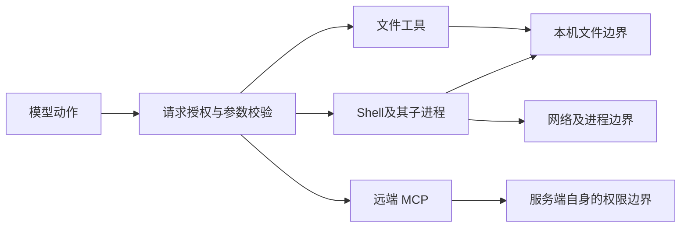

# 第 18 章：沙箱与隔离——把权限落实到执行环境

[教材目录](../README.md)

**先修知识：** 第 17 章的授权模型、操作系统进程和文件路径。**学习目标：** 分解隔离边界；辨认应用层检查与执行期约束；解释平台 fallback 的能力变化；设计最小权限实验。本章讨论安全工程机制，不给出三项目的安全认证结论。

## 18.1 沙箱应当限制什么

沙箱是在某个执行边界内限制主体可观察或改变资源的机制。若模型被误导，提示它“不要读取密钥”仍依赖模型遵守；执行器如果根本不给进程读取密钥的能力，即使模型发出请求也会遇到边界。有效设计需要同时考虑输入端的授权和执行端的约束。

“有沙箱”不是一个足够精确的能力描述。至少应把资源分成以下轴：

| 轴 | 要控制的对象 | 常见遗漏 |
|---|---|---|
| 文件 | 可读根、可写根、删除、重命名、链接 | 只限写仍可读取并外发秘密 |
| 网络 | 目的地、端口、协议、代理、重定向 | 放行一个域名不等于允许任意数据上传 |
| 进程 | 子进程、信号、进程树、环境变量 | 杀父进程后后台后代仍继续运行 |
| 资源 | CPU、内存、输出、时间、磁盘配额 | 权限正确仍可能耗尽机器 |
| 凭据 | 可注入的令牌及作用域 | 整份父进程环境被继承 |

用能力向量 `C=(read, write, network, process, budget)` 描述环境，会比一个名为 `safe` 的布尔值更可审计。不同平台的同名模式不一定覆盖相同内核能力，工具还可能运行在远端环境，所以模式解释必须连同后端、主机及具体 profile 一起读取。

## 18.2 应用层授权与操作系统边界如何协作

应用层通常认识“编辑文件”“执行测试”这类语义，适合做任务授权、资源命名和清晰的拒绝解释。内核或隔离执行服务认识打开文件、建立连接、创建进程等底层操作，适合约束绕过正常工具入口的动作。两者互补：仅检查编辑工具，随后给 shell 广泛权限，会留下另一条写文件路径；只限文件又可能允许读取内容后发往网络。

这张教学图强调**完整中介**：所有到达同一受保护资源的路径都经过相应检查。MCP 服务端可能在另一台机器、使用另一个账号；本机 shell 沙箱不会自动包住其远端副作用。插件在宿主中执行的初始化代码也需要单独评估，不能因为它注册的工具需要批准，就假定插件加载本身没有权限。

## 18.3 贯穿例：允许测试，限制额外副作用

修复 CSV 合计后，Agent 运行 `python -m unittest`。测试除了读取源码，还可能生成字节码、写临时 CSV、启动子进程、下载依赖。一个适合本次任务的教学 profile 可允许读取项目与运行时、写项目和专用临时目录、限制网络、给出 30 秒截止时间，并清理整个进程树。这里的“适合”由实际测试需要决定，不应先授予整机访问再依赖提示词约束。

若失败来自 Python 尝试写全局缓存，优先将缓存重定向到授权目录；若来自缺失依赖，应先判断本地环境是否已有依赖，确需下载再申请指定网络范围。若后端不可用，应该报告无法执行这项受限任务，或进入经过明确授权的另一种执行配置。把任何非零退出码都视为“沙箱挡住了，请关闭沙箱”会把真实代码错误也升级成权限扩大。

## 18.4 三个项目的源码精读

### Codex：先判断需要什么，再选择平台，再变换命令

`get_platform_sandbox` 返回 macOS Seatbelt、LinuxSeccomp 或条件启用的 WindowsRestrictedToken。`should_sandbox` 根据偏好、文件和网络权限判断是否需要沙箱，`select_initial` 则查找具体后端，也有返回 `None` 的分支。由此可见，“需要沙箱”和“这台主机能提供沙箱”是两个事实；不可从选择函数单独推出所有不支持平台都自动拒绝。[codex · get_platform_sandbox](https://github.com/openai/codex/blob/a9b0815167c27ab13719dd12d13b63e02b70d221/codex-rs/sandboxing/src/manager.rs#L50-L64)；[codex · select_initial / should_sandbox](https://github.com/openai/codex/blob/a9b0815167c27ab13719dd12d13b63e02b70d221/codex-rs/sandboxing/src/manager.rs#L313-L350)。

一个具体的拒绝保护位于 `ensure_native_sandbox`：提权仍需保留 denied reads 时，如果实际后端为 None，调用被拒绝。该检查只证明这个分支。`SandboxManager::transform` 在执行边界把基础权限与附加权限合成为有效 profile，再准备原生路径与启动参数；这说明模型侧权限描述还要经过执行器的实际变换。[codex · ensure_native_sandbox](https://github.com/openai/codex/blob/a9b0815167c27ab13719dd12d13b63e02b70d221/codex-rs/core/src/tools/sandboxing.rs#L234-L246)；[codex · SandboxManager::transform](https://github.com/openai/codex/blob/a9b0815167c27ab13719dd12d13b63e02b70d221/codex-rs/sandboxing/src/manager.rs#L355-L383)。

### OpenCode：读清楚已找到的授权边界

`FileAccess.resolve` 按当前目录和工作树分类资源，为外部路径准备 `external_directory` 权限请求；`authorizeExternal` 去重后调用 `permission.assert`。shell 的 `prepare` 扫描命令涉及的目录及命令资源，再做目录和命令授权。这是应用层资源检查，有利于把请求解释给用户。[opencode · resolve / authorizeExternal](https://github.com/anomalyco/opencode/blob/60a212c0769acd96b446acbadeb790486830f91d/packages/core/src/file-access.ts#L93-L141)；[opencode · prepare](https://github.com/anomalyco/opencode/blob/60a212c0769acd96b446acbadeb790486830f91d/packages/core/src/tool/plugin/shell.ts#L123-L154)。

继续追到 `Environment.makeLocalDriver`，可以看到本机文件实现调用 `node:fs` 的读取、写入、删除等方法，并返回传入的 spawner。所检查的这条本机 driver 路径本身不是一个内核隔离器。准确的比较是“这里确认了资源授权及本机 I/O 分层”；它既不能证明所有子进程都被系统沙箱包裹，也不能证明其他宿主或部署没有额外隔离。读者部署时应沿实际 spawner 和远端环境继续核对。[opencode · makeLocalDriver](https://github.com/anomalyco/opencode/blob/60a212c0769acd96b446acbadeb790486830f91d/packages/core/src/environment/local.ts#L17-L72)。

### DeepSeek Harness：策略、后端能力和失败分类分开

`SandboxPolicyService` 默认 read-only，调用时按显式 mode、session override、部署默认的顺序求值，同时把 session cwd 作为 workspace 根。这个服务描述文件效果策略；是否挂载相应工具与后端，是另外的组合事实。[dsh · SandboxPolicyService.Config / resolve](https://github.com/deepseek-ai/deepseek-harness/blob/d743267388641bc76f17c45ce8b4c231aed1d32c/packages/sandbox/sandbox-policy/src/index.ts#L110-L117)；[dsh · SandboxPolicyService.resolve](https://github.com/deepseek-ai/deepseek-harness/blob/d743267388641bc76f17c45ce8b4c231aed1d32c/packages/sandbox/sandbox-policy/src/index.ts#L155-L170)。

`sandbox-local` 的平台链是 Linux bwrap 后 Landlock、macOS Seatbelt、Windows ACL runner。存在多个候选时才做功能探测仲裁，单一候选直接选用，在执行时发现不可用仍可失败；没有可用候选则抛 `SandboxUnavailableError`。Windows 后端标记 partial，Landlock 的探测也可报告 partial。不能把表里的 full 扩写成完整计算机隔离，它是在这些 profile 所承诺的文件效果范围内使用的标签。[dsh · PLATFORM_CHAINS / STATIC_ENFORCEMENT](https://github.com/deepseek-ai/deepseek-harness/blob/d743267388641bc76f17c45ce8b4c231aed1d32c/packages/sandbox/sandbox-local/src/index.ts#L151-L188)；[dsh · selectRunner / chainVerdict](https://github.com/deepseek-ai/deepseek-harness/blob/d743267388641bc76f17c45ce8b4c231aed1d32c/packages/sandbox/sandbox-local/src/index.ts#L497-L520)。

实际 profile 是最有教学价值的地方：bwrap 参数以根只读挂载为基础，workspace-write 再开放工作区与临时区；这段生成器没有加入网络 namespace 隔离参数。Seatbelt profile 从 allow default 开始再拒绝文件写。因此这些已读 profile 主要限制文件写入，不能单凭模式名宣称它们禁止网络外发或保护所有读取。`bash-sandbox` 还区分 runner 本身失败与命令遇到拒绝：已识别 runner failure 优先，并转成 unavailable，而取消保持取消。[dsh · bwrapProfileArgs / seatbeltProfileArgs](https://github.com/deepseek-ai/deepseek-harness/blob/d743267388641bc76f17c45ce8b4c231aed1d32c/packages/sandbox/sandbox-local/src/profiles.ts#L16-L57)；[dsh · SandboxBashExecutor.execute](https://github.com/deepseek-ai/deepseek-harness/blob/d743267388641bc76f17c45ce8b4c231aed1d32c/packages/shell/bash-sandbox/src/index.ts#L115-L130)。

## 18.5 fallback 必须保留可解释的能力差异

fallback 是选择另一种实现，不应该偷偷改写安全承诺。如果首选后端支持某项文件限制，备用后端只能部分执行，返回值应携带 `requested_policy`、`selected_backend`、`enforcement` 与限制说明。上层据此选择拒绝、降级功能或取得授权；只返回“启动成功”会隐藏重要信息。

同样，失败至少应区分：请求被策略拒绝、沙箱后端无法启动、被执行程序内部失败、超时或取消。前两者不是同一种重试条件。退避重试适合暂时故障，扩大权限改变了安全条件，不能作为普通重试参数自动插入。

拟议实验应在独立临时目录中使用假秘密和本机测试服务，观察项目内外读写、符号链接、子进程遗留与网络请求。对每个测试保存 OS、后端版本、最终 profile、预期和实际结果。本章**未运行这些实验，也未运行上游沙箱测试**；源码分支和注释不是实验结果。

## 18.6 习题与参考答案

1. **概念题：** 一个环境只允许写工作区，却允许读取整机和任意联网，能否称为秘密隔离？ 
   **参考答案：** 不能。读取和外发构成另一条数据流；文件写限制主要保护完整性，需要额外读取边界、凭据范围和网络控制才能讨论秘密隔离。
2. **源码题：** 为什么不能把 DSH 的 full 标签解释为网络也受限？ 
   **参考答案：** 标签来自文件策略后端；已读 bwrap 和 Seatbelt profile 主要控制文件效果。必须另找网络执行约束并验证，而不能让一个标签跨越未描述的能力轴。
3. **故障题：** 测试程序自己打印“permission denied”然后返回 1，应怎样分类？ 
   **参考答案：** 单一字符串不足以证明内核拒绝或 runner 没有启动。需要启动阶段、后端特定退出码及诊断等独立证据；分类仍不确定时应保留不确定性，不能自动扩大权限。
4. **设计题：** 为 CSV 测试列出最小权限与三个负向实验。 
   **参考答案：** 只读运行时与所需源码，只写测试输出及专用临时区，无需网络时关闭外连，限制时间和进程树。负向实验可尝试写同级未授权目录、通过链接绕出根目录、让后代进程在取消后继续写心跳；预期均受对应边界控制，并实际记录结果。

延伸阅读：[原有 DSH 工具与沙箱笔记](../../agent-infra-study/dsh/03-tools-sandbox.md)。下一章把这些边界用于提示注入与秘密保护。
