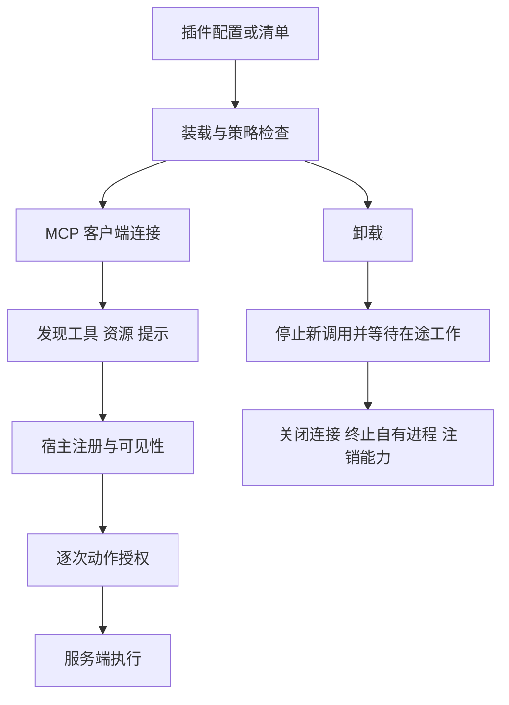

# 第 20 章：MCP 与插件——扩展能力的协议、生命周期和信任

[教材目录](../README.md)

**先修知识：** 工具 schema、异步资源管理，以及第 17—19 章。**学习目标：** 区分协议连接与插件装配；追踪发现、调用和卸载；理解认证与授权的不同职责；处理工具目录变化和资源清理。本章依据固定版本的实现讲机制，不把某次实现等同于所有 MCP 协议版本的规范。

## 20.1 为什么需要两种扩展抽象

工具接口解决“怎样调用一个能力”，却没有独自解决“怎样找到它、谁负责启动它、如何知道它更新了、退出时谁清理”。MCP 为宿主与能力服务之间提供共同的协议接口；插件则通常是宿主的部署和扩展单元，可以贡献工具、指令、配置、事件钩子或 UI。二者有关联，但不是一一对应：一个插件可以带多个 MCP 服务，也可以只提供本地功能；一个 MCP 服务也可以被手动配置而不经过插件包。

在本章的教学模型中，**宿主**拥有用户会话、模型调用和策略；**客户端**拥有与一个服务的协议连接；**服务端**发布能力并处理请求。工具用于动作调用，资源用于读取有标识的数据，prompt 用于可参数化的提示模板。服务端声明“我有这个工具”只证明协议目录中的声明，实际可见性还受到宿主配置、权限和上下文预算影响。

这个生命周期同时是所有权关系：谁创建连接，谁负责关闭；谁注册工具，谁持有注销句柄；谁启动子进程，谁确认它退出。仅把工具从模型列表删掉，不能证明服务端进程或远端 session 已停止。

## 20.2 贯穿例：给 CSV 修复接入一个验证服务

假设插件提供 `csv_check` 工具和一份 CSV 格式资源。Agent 先发现 schema，读取格式说明，再把最小的测试样本交给验证工具，结合本地回归测试判断修复是否正确。工具目录带有服务器身份、原始名称、输入 schema 和当前世代；调用时依然需要检查这份样本是否允许交给该服务。

后来服务更新，把 `csv_check` 的输入从本地路径改为文件内容。若宿主继续用旧 schema 生成请求，却把请求发给新服务，就可能失败或发出比预期更大的数据。工程上可以把目录绑定连接世代，原子替换一整套工具，并让过时调用明确失败后重新规划。尤其不能因网络断开就无条件重发有副作用的动作：客户端没收到结果，不说明服务端没执行。列表查询和写操作需要不同重试策略。

## 20.3 认证、命名与授权分别负责什么

认证回答“这个连接以谁的身份访问哪个服务”；授权回答“当前任务是否允许这次动作”。OAuth token 的 scope 规定服务端许可范围，但它通常不理解这次 CSV 修复是否需要上传全项目。已登录也不意味着所有工具调用都被用户授权。

命名则解决路由：两个服务都提供 `search` 时，需要保留服务器命名空间。名称规范化还可能碰撞，因此注册器需要冲突检测。插件描述、MCP 指令和 schema 都属于供应链输入；其作用是说明如何使用能力，不应自行赋予它们改变宿主规则或读取全部凭据的权限。

## 20.4 三个项目的源码精读

### Codex：协议状态机与插件能力清单分层

`RmcpClient::initialize` 在锁内取走 Connecting 状态的 transport，拒绝重复初始化和 Closed 状态；握手完成并取得 server info 后才设为 Ready，还再次检查并发关闭。这是连接准备阶段的状态机。`list_tools` 调用前刷新 OAuth，调用后持久化相应凭据状态，并通过带超时的服务操作执行列举。`shutdown` 先把状态换为 Closed，再尝试终止自己拥有的 stdio 进程；终止失败会留下警告，不能把“已调用 shutdown”说成“已证明所有资源清理成功”。[codex · RmcpClient::initialize](https://github.com/openai/codex/blob/a9b0815167c27ab13719dd12d13b63e02b70d221/codex-rs/rmcp-client/src/rmcp_client.rs#L638-L684)；[codex · RmcpClient::list_tools](https://github.com/openai/codex/blob/a9b0815167c27ab13719dd12d13b63e02b70d221/codex-rs/rmcp-client/src/rmcp_client.rs#L696-L713)；[codex · RmcpClient::shutdown](https://github.com/openai/codex/blob/a9b0815167c27ab13719dd12d13b63e02b70d221/codex-rs/rmcp-client/src/rmcp_client.rs#L1061-L1075)。

插件层则在 loader 中把启用配置与 `allows_plugin` 策略合成。`AllCapabilities` 路径加载技能和 MCP server 清单；这个固定版本还区分 manifest 格式：apps 在 Legacy 分支加载，AgentPlugin 在所示 hooks 分支返回空集合。由此可见，不能把一个历史 manifest 示例中的所有能力都写成所有当前插件格式的统一合同。[codex · load_plugins_from_layer_stack_with_scope](https://github.com/openai/codex/blob/a9b0815167c27ab13719dd12d13b63e02b70d221/codex-rs/core-plugins/src/loader.rs#L178-L189)；[codex · load_plugin capabilities](https://github.com/openai/codex/blob/a9b0815167c27ab13719dd12d13b63e02b70d221/codex-rs/core-plugins/src/loader.rs#L921-L976)。

### OpenCode：scope 清理与 OAuth 身份约束

当前 `mcp/client.ts` 的 local 路径创建 stdio transport，remote 路径创建带 authProvider 的 Streamable HTTP transport。连接 finalizer 在存在旧式 sessionId 且尚未报告失效时，先限时终止 session，再关闭客户端；这是带条件的旧会话清理，不能推广成每个协议世代都必须发送同样终止请求。目录列举走可重试封装，体现只读发现与执行的区别。[opencode · connect](https://github.com/anomalyco/opencode/blob/60a212c0769acd96b446acbadeb790486830f91d/packages/core/src/mcp/client.ts#L246-L277)；[opencode · connect finalizer / catalog](https://github.com/anomalyco/opencode/blob/60a212c0769acd96b446acbadeb790486830f91d/packages/core/src/mcp/client.ts#L294-L340)。

OAuth provider 校验发现的 protected resource 是否覆盖配置的服务身份，并要求存在 PKCE verifier。回调逻辑生成随机 state，收到回调后精确匹配。这些机制保护认证流程中的身份关联；它们不判断某个工具参数是否符合用户任务。[opencode · OAuth provider validateResourceURL / codeVerifier](https://github.com/anomalyco/opencode/blob/60a212c0769acd96b446acbadeb790486830f91d/packages/core/src/mcp/oauth.ts#L166-L210)；[opencode · OAuth callback](https://github.com/anomalyco/opencode/blob/60a212c0769acd96b446acbadeb790486830f91d/packages/core/src/mcp/oauth.ts#L352-L376)。

插件生命周期也已有当前源码，而不必借历史 ADR 推断：`PluginSupervisor.resolve` 在新 revision 加载失败时保留已经运行的 generation，同时记录 failed 状态。宿主关闭时，registry 的 finalizer 被安排在其捕获服务关闭前卸载插件。保留旧版本改善可用性，也要求 UI 清楚展示“新版本失败、旧版本仍运行”，避免用户误认更新已生效。[opencode · resolve](https://github.com/anomalyco/opencode/blob/60a212c0769acd96b446acbadeb790486830f91d/packages/core/src/plugin/supervisor.ts#L59-L96)；[opencode · PluginSupervisor.layer](https://github.com/anomalyco/opencode/blob/60a212c0769acd96b446acbadeb790486830f91d/packages/core/src/plugin/supervisor.ts#L124-L141)。

### DeepSeek Harness：组合式插件与连接世代

`createTransport` 对 stdio 使用 scrubbed parent env，再叠加明确配置的 env；HTTP 路径传入配置 headers。这段工厂可证明这两种凭据进入传输的方式，没有展示完整交互式 OAuth 状态机，不能从它外推整个仓库支持或不支持所有认证流程。插件加载先保留唯一 serverName，再把 dispose 注册为 Cordis effect，并等待首次连接与工具发现；严格启动模式遇到失败会拒绝该插件激活。[dsh · buildChildEnv / createTransport](https://github.com/deepseek-ai/deepseek-harness/blob/d743267388641bc76f17c45ce8b4c231aed1d32c/packages/mcp/mcp-client/src/transport.ts#L15-L44)；[dsh · apply lifecycle](https://github.com/deepseek-ai/deepseek-harness/blob/d743267388641bc76f17c45ce8b4c231aed1d32c/packages/mcp/mcp-client/src/index.ts#L158-L201)。

`syncTools` 先取完整目录并构造下一代定义，成功后才注销旧代并注册新代；注册冲突会回滚本次已注册工具，避免模型看到半套能力。连接 supervisor 用 `isCurrent` 限制旧世代行动，把同步操作串起来；失败世代如果无法确认 transport 关闭，则停止重连，避免旧进程和新进程重叠。dispose 先停止定时器与连接，再等待在途 attempt 和 syncChain 静止，最后注销工具。这些都是实在的生命周期机制，而不只是一个名为 close 的 API。[dsh · syncTools](https://github.com/deepseek-ai/deepseek-harness/blob/d743267388641bc76f17c45ce8b4c231aed1d32c/packages/mcp/mcp-client/src/tools.ts#L119-L161)；[dsh · isCurrent / enqueueSync / settleFailedGeneration](https://github.com/deepseek-ai/deepseek-harness/blob/d743267388641bc76f17c45ce8b4c231aed1d32c/packages/mcp/mcp-client/src/connection.ts#L159-L196)；[dsh · ConnectionHandle.dispose](https://github.com/deepseek-ai/deepseek-harness/blob/d743267388641bc76f17c45ce8b4c231aed1d32c/packages/mcp/mcp-client/src/connection.ts#L388-L406)。

## 20.5 设计一个可维护的扩展合同

教学设计可把插件实例建模为 `PluginInstance(id, revision, registrations, connections, cleanup)`，把工具路由建模为 `(plugin_id, server_id, generation, raw_tool_name)`。调用快照确定后，不应在执行途中把同名工具换到另一个服务。更新时先构造新代，验证配置与发现，再按明确规则替换；若保留旧代，要向观察者发布真实状态。

错误也应具有足够分类：下载失败、配置无效、认证缺失、握手失败、目录冲突、工具执行失败、清理未完成，对用户与重试器分别意味着不同下一步。工具 schema 的良好类型信息减少无效调用，但不表达完整业务授权；`readOnly` 等提示元数据也不应在没有可信来源和服务约束时成为唯一安全依据。

供应链治理需要确认来源、版本、校验与更新策略，运行时需要限制凭据、进程和数据出口。卸载则至少清理工具、连接、监听器、计时器和自有子进程；持久化凭据是否保留应有独立、可解释的产品规则。删除插件文件并不自然撤销远端 token。

本章没有运行 MCP 互操作、认证或插件生命周期测试。以下习题的实验均是**建议方案，未执行**；源码引用只证明固定版本中的所述路径。

## 20.6 习题与参考答案

1. **概念题：** 为什么安装插件、登录账号、批准工具调用是三个不同动作？ 
   **参考答案：** 安装改变宿主可用代码与能力；登录建立服务身份；批准把用户任务授权落实到具体副作用。三者作用域与撤销机制不同，任何一步不能自动替代另外两步。
2. **源码题：** DSH 为什么等待 syncChain 后才注销最后一代工具？ 
   **参考答案：** 正在进行的连接或目录同步仍可能注册工具。先注销再等待会被迟到同步重新注册，造成幽灵工具或资源泄漏；等待静止后，拥有者才能释放最终集合。
3. **故障题：** OpenCode 新版插件加载失败但旧版仍运行，状态应怎样呈现？ 
   **参考答案：** 明确记录目标新版失败、当前仍运行旧 revision；不能显示更新成功，也不能笼统说插件不可用。保留旧版是可用性选择，需要与版本真实性配套。
4. **设计题：** 为 CSV 验证插件设计四个生命周期实验。 
   **参考答案：** 首次握手超时后无遗留进程；工具列表更新时无半套注册；卸载与在途目录更新竞争后不再出现工具；工具调用断线时不盲目重复产生副作用。分别观测进程、注册表、调用 ID 与服务端账本，才能判断结果。

延伸阅读：[Codex 扩展笔记](../../agent-infra-study/codex/05-extension-architecture.md)、[OpenCode 扩展笔记](../../agent-infra-study/opencode/05-extension-architecture.md)、[DSH 扩展笔记](../../agent-infra-study/dsh/05-extension-architecture.md)。
