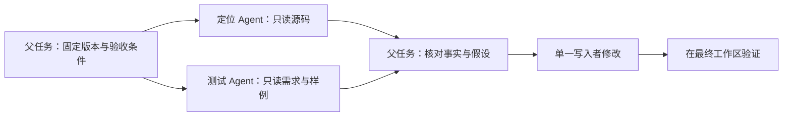

# 第 21 章　多 Agent：分解工作、传递证据与控制共享状态

[教材目录](../README.md)

**先修知识**：Agent 循环、工具调用、上下文窗口、异步任务与会话持久化。**学习目标**：能够决定什么时候委派、设计子任务契约，区分上下文隔离与文件隔离，并在子任务失败、重试和并发修改时正确归并结果。

## 21.1 为什么“多开几个模型”还不是协作系统

单个 Agent 的瓶颈可能是上下文太杂、任务可以并行，也可能只是缺少准确的测试反馈。只有前两类问题可能通过委派改善。若总时间主要花在一个串行构建上，创建五个 Agent 不会使构建快五倍，反而可能争用 CPU。若五个 Agent 阅读同一份有误摘要，它们的一致意见也不是五份独立证据。

本章把**委派**定义为：父任务将一个有边界的工作单元交给另一个执行主体，并承担验收其结果的责任。**角色**是提示词、模型、工具和权限的组合；它不是正确性的证明。**拓扑**描述谁能创建谁、给谁发消息、等待谁。星形拓扑便于父任务汇总；树形拓扑适合逐层分解但容易膨胀；任意节点互通的网络方便协商，却增加重复工作、消息环和责任不清的风险。这些是教学分类，不意味着三个项目都实现了全部拓扑。

有用的委派单位要尽量满足：输入已经充分，输出可独立验收，读写边界明确，失败不会使所有分支失去意义。一个可执行的子任务契约至少有 `task_id、目标、输入快照、可写范围、完成条件、返回格式、预算`。其中输入快照应包含源码版本和必要事实；“参考我们刚才的讨论”对新上下文没有意义。

## 21.2 贯穿案例：修复 CSV 合计错误

设 `sum.py` 只累加 price，漏乘 quantity：pen 的 3.50×2 与 book 的 12.00×3 错算成 15.50，正确结果为 43.00，金额使用 Decimal。目标是修复后通过正常金额、小数和空文件测试。父 Agent 可以把工作拆成：A 只读分析解析与合计逻辑，B 只读设计边界测试，父 Agent 根据二者证据修改 `sum.py` 和测试。这个小任务未必值得并行；这里用它展示契约。在更大的仓库中，A 与 B 可对应互不重叠的模块。

```text
任务 A：基于 revision R，定位 CSV total 错误；不修改文件。
返回：{定位, 最小复现, 证据路径, 修复建议, 未验证事项}
任务 B：基于同一 R，设计金额语义的测试；不修改文件。
返回：{输入, 预期输出, 判断依据, 尚不明确的业务规则}
父任务：检查证据 → 核对 Decimal 约束 → 修改 → 运行测试 → 交付
```

为何父任务仍要核对金额语义？A 可能遗漏已给定的 Decimal 约束而建议浮点求和，B 则按精确十进制设计断言。二者的假设不一致，父任务必须据原始契约纠正偏差。归并不是拼接文本，而是解决假设冲突。若确需并行写入，应按文件或模块指定唯一写入者，或者使用独立 checkout，最后在同一版本上重新验证。会话各自拥有上下文，并不自动意味着它们各自拥有文件系统。



## 21.3 三个项目中的委派边界

**Codex：创建子线程时记录来源与上下文选择。** 在此固定版本的 V1 入口 `handle_spawn_agent` 中，处理器先计算 `child_depth` 并拒绝超过 `agent_max_depth` 的请求；随后按 `fork_context` 准备配置和 `FullHistory` 模式。真正的 `SpawnRequest` 带有父线程、父 turn、根 turn 以及环境信息。读代码时应把“角色名”“上下文继承”“执行身份”分开看：角色影响配置，fork 决定历史来源，ID 则让运行时关联生命周期。它们不等价于独立磁盘工作区。[Codex：深度检查与配置准备](https://github.com/openai/codex/blob/a9b0815167c27ab13719dd12d13b63e02b70d221/codex-rs/core/src/tools/handlers/multi_agents/spawn.rs#L64-L112)，[SpawnRequest 来源信息](https://github.com/openai/codex/blob/a9b0815167c27ab13719dd12d13b63e02b70d221/codex-rs/core/src/tools/handlers/multi_agents/spawn.rs#L113-L139)。

对应的等待处理器先订阅各目标的状态，接受已到终态的结果；否则并发等待第一个终态，再收集当下已经就绪的其他结果。超时通过 `timed_out` 单独表达。这提示我们：等待返回不是“所有子任务成功”，而是一次状态观察；调用者要识别尚未结束、失败、找不到和完成等不同情形。[Codex：`Handler::handle_call`](https://github.com/openai/codex/blob/a9b0815167c27ab13719dd12d13b63e02b70d221/codex-rs/core/src/tools/handlers/multi_agents/wait.rs#L123-L219)。这里展示的是具名入口的代码路径，不把 V1 创建接口泛化为所有多 Agent 接口的完整规范。

**OpenCode：子会话、权限检查与后台 Job。** `SubagentTool` 的公开说明明确新建 child 使用 fresh context；继续旧 child 则传 `sessionID`。实现沿 `parentID` 计算嵌套深度、检查角色可否作为子 Agent、执行权限断言，并拒绝继续一个不属于当前父会话的 session。模型选择顺序是显式覆盖、角色配置、父会话模型。这个顺序与“复制整个父历史”不是同一件事。[OpenCode：工具输入与上下文契约](https://github.com/anomalyco/opencode/blob/60a212c0769acd96b446acbadeb790486830f91d/packages/core/src/tool/plugin/subagent.ts#L29-L62)，[深度、权限及归属检查](https://github.com/anomalyco/opencode/blob/60a212c0769acd96b446acbadeb790486830f91d/packages/core/src/tool/plugin/subagent.ts#L117-L167)，[模型与子会话创建](https://github.com/anomalyco/opencode/blob/60a212c0769acd96b446acbadeb790486830f91d/packages/core/src/tool/plugin/subagent.ts#L168-L198)。

前台路径阻塞等待 Job，后台路径立即返回 `running`。完成投递把 completed/error/cancelled 转成 synthetic 消息，附 child ID、agent 和状态；有 `notificationID` 时完成后台通知登记。因此父会话收到的是有来源的结果消息，而不是悄悄改写先前的工具返回。CSV 案例应在最终验证前确认 B 的后台结果已被处理。[OpenCode：启动与等待](https://github.com/anomalyco/opencode/blob/60a212c0769acd96b446acbadeb790486830f91d/packages/core/src/tool/plugin/subagent.ts#L200-L240)，[`SubagentCompletion.deliver`](https://github.com/anomalyco/opencode/blob/60a212c0769acd96b446acbadeb790486830f91d/packages/core/src/session/subagent-completion.ts#L21-L45)。

**DeepSeek Harness：生命周期归属与结构化结果提交。** `startLocal` 在首次 `await` 之前快照子任务描述和委派策略，避免父 Agent 后续切换策略影响正在创建的 child；以 child ID 锁住建立过程，并保存 parent、深度、继承事件数量等信息。`delegationDepthOf` 取持久 header 深度与运行时深度的最大值，避免恢复后的 child 用默认零深度绕过递归限制。[DSH：`startLocal`](https://github.com/deepseek-ai/deepseek-harness/blob/d743267388641bc76f17c45ce8b4c231aed1d32c/packages/subagent/subagent/src/manager.ts#L379-L456)，[`delegationDepthOf`](https://github.com/deepseek-ai/deepseek-harness/blob/d743267388641bc76f17c45ce8b4c231aed1d32c/packages/subagent/subagent/src/depth.ts#L18-L35)。

这个版本的 `sendMessage` 要求发送方是确切的 live Agent，并按相邻父子关系路由；持久 parent ID 相同但生命周期不符合要求仍会拒绝。由此不能推导出任意 peer 之间都能直接通信。[DSH：`sendMessage`](https://github.com/deepseek-ai/deepseek-harness/blob/d743267388641bc76f17c45ce8b4c231aed1d32c/packages/subagent/subagent/src/manager.ts#L537-L575)。

结构化 child 还有一个容易漏读的边界：`structured_output` 先验证 schema、检查待处理输入及下属工作，再暂存结果；只有最终 `tools/result` 成功才提交。如果它被包在 `run_code` 中，还要等外层结果成功。工具函数返回不等于完整执行管线接受结果；这个两阶段捕获使父任务不会提前拿到后来已失败的“成功对象”。[DSH：`attachStructuredRuntime`](https://github.com/deepseek-ai/deepseek-harness/blob/d743267388641bc76f17c45ce8b4c231aed1d32c/packages/subagent/subagent/src/structured.ts#L94-L105)，[提交与终态守卫](https://github.com/deepseek-ai/deepseek-harness/blob/d743267388641bc76f17c45ce8b4c231aed1d32c/packages/subagent/subagent/src/structured.ts#L115-L153)。

## 21.4 归并算法与不变量

教学用归并流程如下。`reported_success` 只是子任务声明，`accepted` 才是父任务验收状态。

```text
收到 result(task_id, base_revision, artifacts, evidence, status):
  检查任务身份与是否重复投递
  若 base_revision 与当前依赖版本不兼容：重读或要求重做
  若 status 失败：记录影响范围，决定重试、缩小任务或中止
  若声明成功：验证产物存在、证据可重现、完成条件成立
  检查写入集合与其他任务是否相交
  归并后在同一最终版本执行验收
```

核心不变量是：同一文件不能在不知情的情况下拥有多个写入者；来自旧版本的验证不能替新版本背书；子任务完成不能自动提升为整体完成；取消也必须等待资源与写入真正停止后再移交所有权。完整上下文继承减少交接遗漏，却增加 token 与旧假设污染；新上下文降低噪声，却要求更好的任务说明。并发度上限控制同时运行的数量，递归深度控制树的高度，累计工作预算控制总消耗，三者不能互相替代。

故障例：A 与 B 都改了 `sum.py`，A 的测试先通过，B 随后覆盖了 A 的修改。若父任务直接转述 A 的“通过”，就生成了一个从未被验证的最终产物。修复方法是收窄写入权、检查最终 diff，再对最终文件运行验证；增加一个“汇总 Agent”本身不能消除这个竞态。

## 21.5 练习与参考答案

1. **选择题式判断**：只有两个独立目录可修改，但任务依赖一个必须串行运行的数据库迁移，是否应让四个 Agent 同时执行迁移？**参考答案**：不应。可并行分析两个目录，迁移应有单一执行者和明确完成屏障；Agent 数量不改变资源依赖图。
2. **上下文设计**：给 CSV 测试 Agent 的最小输入是什么？**参考答案**：目标版本、CSV 列定义、金额精度及空值规则、可读路径、不可写范围、验收格式。仅给 bug 标题会使其自行猜测业务语义。
3. **读源码题**：为何 DSH 用执行对象而非可能重复的 call ID 暂存结构化结果？**参考答案**：执行对象标识一次真实的管线执行；复用 call ID 不应导致另一调用提交或删除当前结果。仍需等外层 transport 的最终结果。
4. **设计题**：为十个并行修复任务设计合并策略。**参考答案**：固定 base commit，按模块划分唯一写入者，返回补丁与测试证据，父任务检查交叉依赖；按依赖顺序合并，发生版本漂移的证据失效，最终统一验收。若任务不能分割写入范围，应减少并发，或采用独立 checkout 与显式冲突解决。

本章代码映射来自固定提交的静态阅读；上述 CSV 委派方案是教学设计，未运行三个项目的真实多 Agent 实验。
