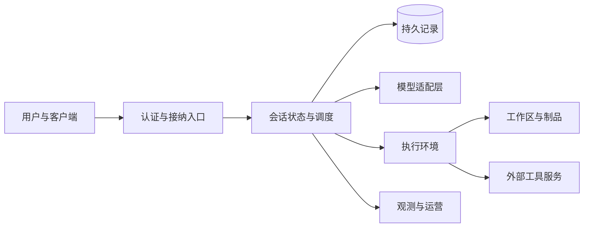

# 第 25 章 从本地运行到可运营服务

[教材目录](../README.md)

**前置知识**：第 15—19 章的恢复、事件、权限与隔离。读完本章，你应能画出一个 Agent 的部署边界，解释为什么进程启动成功不等于任务可恢复，并设计升级与停机的验收条件。

## 25.1 部署会改变问题的性质

在个人电脑上，用户、文件所有者、Agent 操作者往往是同一个人；把相同程序放进服务器后，这几个身份可能分开。浏览器用户发起任务，服务账户保存历史，执行容器访问仓库，模型供应商处理输入，远程工具使用另一套凭证。每一道边界都需要明确“谁拥有资源，谁能发起动作，谁负责清理”。

因此部署规格至少包含五类资源：入口和认证、会话状态、执行环境、模型与工具连接、后台工作。它们的生命周期通常不同：浏览器页面关闭后，会话记录仍应存在；模型请求取消后，终端进程可能尚未退出；服务器升级后，旧工具的外部副作用不会自动撤销。把这些资源统一交给一个 HTTP 请求的生命周期，会同时产生任务丢失和资源泄漏。

以下是教学部署模型，并非三个项目共享的真实拓扑：

图中最容易被忽略的是数据库与工作区的分离。数据库记录“补丁已执行”不能证明文件仍存在，文件已经改变也不能证明结果已被记录。部署设计必须给出两者失配后的处理方式。

## 25.2 三种部署方式的适用条件

**本地进程**把启动与文件访问做得简单，适合个人工作区。但长任务受到休眠、终端退出和本机资源的影响。**应用内嵌**让上层应用直接拥有运行时，减少进程间连接，但内存、依赖和故障隔离也与宿主绑定。**独立服务加执行器**可以分离连接管理与工作负载，代价是增加协议、身份传播、重连和恢复逻辑。

选择时先问资源边界，再问使用哪种界面。例如教学任务是“修复 CSV 总价”，本地学习环境只需一个临时工作区；若给多个团队提供该任务，则同名路径、相同 session ID、共享模型密钥和共享缓存都可能成为跨租户问题。多会话能力并不能自行回答这些问题。

| 设计问题 | 本地教学环境 | 共享服务所需设计 |
|---|---|---|
| 工作区归属 | 当前学习者的临时目录 | 租户与任务绑定、路径验证、配额 |
| 数据库寿命 | 一次实验或显式文件 | 备份、迁移、恢复演练、保留策略 |
| 调用者身份 | 本机操作员 | 入口身份映射到任务和工具凭证 |
| 任务停止 | 进程结束后观察结果 | 停止接纳、收敛活跃执行、保存检查点 |
| 资源回收 | 删除临时目录 | 处理孤儿进程、失联执行器与过期制品 |

这是需求比较，不是产品成熟度评分。

## 25.3 Codex 的传输与宿主选项

固定版本的 `AppServerArgs` 将监听传输、`SessionSource`、WebSocket 认证参数、严格配置检查和 managed-daemon 选项分开；`main` 先把认证参数转换为 settings，再把传输与运行选项传给 `run_main_with_transport_options`。源码列出 stdio、Unix socket、WebSocket 和关闭监听等形式。由此可见传输是宿主入口的选择，并不等于改变核心任务语义。[Codex 入口与参数](https://github.com/openai/codex/blob/a9b0815167c27ab13719dd12d13b63e02b70d221/codex-rs/app-server/src/main.rs#L30-L129)

读者应注意 `managed_daemon` 是特定启动模式的选项，不能由此推断任意部署都自动保存所有运行状态。官方 app-server 文档给出一个更具体的运营契约：优雅停机拒绝新工作时返回 `serverShuttingDown` 原因；应用网络策略在启动及显式重载时读取，更新后取消不再允许的请求，加载失败会阻断流量。[停机错误](https://github.com/openai/codex/blob/a9b0815167c27ab13719dd12d13b63e02b70d221/codex-rs/app-server/README.md#L22-L26)、[网络策略契约](https://github.com/openai/codex/blob/a9b0815167c27ab13719dd12d13b63e02b70d221/codex-rs/app-server/README.md#L113-L123)

教学意义是把“拒绝新任务”“处置现有任务”“切换网络策略”作为三个状态转换验证。一个健康检查只检查监听端口，覆盖不到这些转换。

## 25.4 OpenCode 的应用内嵌与状态寿命

OpenCode 的 `EmbeddedHost.create` 使用 `createEmbeddedRoutes` 建立内存内 HTTP handler，默认数据库路径为 `:memory:`；用户选项可以覆盖这个默认值。它注册宿主插件后启动 `resumeSuspendedSessions` 后台 fiber，并把 handler 与 `runtime.dispose` 交给 `OwnedFetch`。这给出了一条明确的“创建宿主—装配能力—恢复工作—请求服务—释放宿主”路径。[EmbeddedHost 实现](https://github.com/anomalyco/opencode/blob/60a212c0769acd96b446acbadeb790486830f91d/packages/sdk/src/internal/host.ts#L30-L70)

SDK 文档说明它执行 server 已装配的路由，不开监听端口；`close()` 与异步 dispose 释放路由资源、Location 服务、fiber 和注册。若需要重启后恢复，必须选择持久数据库路径，不能依赖默认的内存数据库。[SDK 生命周期与恢复契约](https://github.com/anomalyco/opencode/blob/60a212c0769acd96b446acbadeb790486830f91d/packages/sdk/README.md#L1-L29)、[重启行为](https://github.com/anomalyco/opencode/blob/60a212c0769acd96b446acbadeb790486830f91d/packages/sdk/README.md#L61-L76)

同一文档还指出 Session-selected instance 的选择不是授权或存储隔离边界。实例键适合决定哪些会话共享应用插件，而租户隔离还要由应用明确建立。教学反例是把 `instanceKey = customerId` 当作完整隔离方案：这只回答实例分配，尚未回答数据库查询、插件持久存储和凭证能否跨客户访问。

## 25.5 DSH 的载体与能力装配

DSH 的 WebServer 是 HTTP/HTTPS 载体，路由由组合中的其他插件注册。官方文档明确它不理解 Agent loop，Electron 则使用 file 与 IPC 的另一条路径。把载体和 Agent 能力分开，意味着可以调整呈现与连接方式，但也意味着应用必须正确装配认证和路由策略。[WebServer 分层契约](https://github.com/deepseek-ai/deepseek-harness/blob/d743267388641bc76f17c45ce8b4c231aed1d32c/docs/subsystems/web-server.md#L1-L27)

其源码中 TLS 初始化读取证书与私钥，失败会抛错；释放阶段除 `closeAllConnections` 外，还显式销毁升级连接和尚未完成握手的 TLS socket，并等待关闭。这不是抽象的“支持清理”，而是在处理长连接使进程无法退出的具体故障。[TLS 创建](https://github.com/deepseek-ai/deepseek-harness/blob/d743267388641bc76f17c45ce8b4c231aed1d32c/packages/host/webserver/src/index.ts#L428-L446)、[连接释放](https://github.com/deepseek-ai/deepseek-harness/blob/d743267388641bc76f17c45ce8b4c231aed1d32c/packages/host/webserver/src/index.ts#L493-L507)

文档同时区分载体与 shipped Web composition：载体本身不拥有认证及 Origin 策略，后者由 Connection 插件提供。阅读“支持 HTTPS”时，要继续问“请求主体是谁”“路由是否经过接纳”“升级连接走什么路径”。本章引用的是固定版本的装配契约，未进行实际部署或网络安全验证。[部署与认证边界](https://github.com/deepseek-ai/deepseek-harness/blob/d743267388641bc76f17c45ce8b4c231aed1d32c/docs/subsystems/web-server.md#L80-L86)

## 25.6 一次升级如何验收

为 CSV 修复服务升级工具 schema 时，旧会话可能仍含旧参数、旧工具结果和待处理批准。直接替换代码只能保证新进程存在，不能保证旧任务继续合理运行。

教学方案是先保存应用版本、工具 schema 版本、配置来源和数据库版本，再停止接纳新任务，让已执行动作进入可解释的终态。对于“请求已发出、结果未知”的外部写入，升级记录应保留未知状态，恢复时查询外部系统，不能统一重放。迁移后用固定样本验证：旧历史可读、旧工具结果可解释、批准不越权、重复接纳不重复执行、新任务可正常完成。

回滚也需要兼容范围。若数据库迁移不可逆，回滚二进制未必可用；若新版本已发出外部动作，回滚更不会撤销该动作。教学上应把恢复点写成“可回到哪一种状态”，而不是只写一个旧镜像标签。

运营观测至少分开三层：入口是否可用，执行器是否能完成受限的探测任务，持久状态是否可读取并恢复。第 23 章的延迟与成本指标应带同一任务标识，才能区分排队、模型和工具造成的等待。

## 25.7 练习与参考答案

1. **分析题**：内嵌 SDK 所有工具测试通过，但重启后会话消失，首先检查什么？ 
   **参考答案**：检查数据库是否仍使用默认内存路径、调用者是否显式提供持久路径，以及启动恢复读取的是否为同一数据库。工具正确性与状态寿命是不同验收项。
2. **设计题**：浏览器关闭时是否应取消任务？ 
   **参考答案**：取决于产品契约。将连接与任务寿命分离，明确继续后台运行、主动取消和空闲过期三种事件；关闭连接只能证明客户端失联，不能自动证明用户撤回任务。
3. **故障题**：服务已发出补丁写入，但停机超时，重启后没有工具结果。 
   **参考答案**：检查目标版本或操作标识确认是否已应用；在无法查询时标记未知并要求协调，不能把缺少日志等同于未执行。
4. **部署实验，NOT RUN**：在隔离开发环境为任一项目设计一次“活跃任务期间优雅停机”。记录停止接纳时间、工具进程结束、检查点可读、重启后的终态。 
   **验收要点**：四项分别举证；若只得到进程退出码，实验仍不足以说明任务恢复正确。
