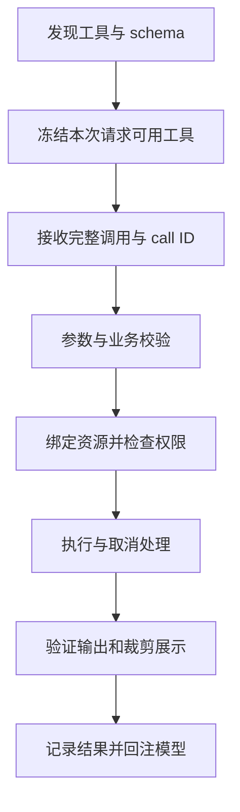

# 第 26 章 为 Agent 增加一种能力

[教材目录](../README.md)

**前置知识**：第 6、8、12、20 章。读完本章，你应能为一个新工具写出完整契约，选择适当的扩展位置，并解释注册、启用、授权、执行和卸载之间的区别。

## 26.1 从需求决定扩展位置

假设 CSV 修复 Agent 每次都手工解析金额，常把 `price × quantity` 写成 `price`。我们想加入 `inspect_csv_total` 能力，返回列名、行数、金额计算结果，并在错误中指出问题行。

有四种看似都可行的实现。写一段提示词，只是在教模型如何判断；增加 skill，提供可复用步骤与资料；增加工具，让程序完成确定性的解析计算；更换模型适配器，改变模型接入方式。这里应选择工具，因为需要的是可执行、可独立测试的计算。提示词仍可以说明何时调用，但不应成为金额计算的唯一实现。

扩展点选择可以从变化对象倒推：知识变化进入指令或检索，动作变化进入工具，决策流程变化进入 loop 或 runner，呈现变化进入客户端，协议变化进入适配器。跨越边界并非绝对错误，但必须说明谁因此获得新的责任。

## 26.2 先写契约再写处理函数

下面是教学规格，不是三项目共用的可直接安装 API：

```json
{
  "name": "inspect_csv_total",
  "input": {"artifact_id": "string", "price_column": "string", "quantity_column": "string", "expected_revision": "string or null"},
  "output": {"total_decimal": "string", "row_count": "integer", "columns": "string[]", "source_revision": "string"},
  "effects": "read_only",
  "limits": {"maximum_bytes": 1048576},
  "errors": ["missing_column", "invalid_decimal", "stale_revision", "too_large"]
}
```

`artifact_id` 比任意路径更容易绑定到当前任务的授权范围，但它仍需要宿主解析与权限检查；字符串看起来像 ID 并不会自行产生隔离。`total_decimal` 使用十进制字符串，避免把金额展示精度与浮点累积误差混为一谈。`source_revision` 让模型下一步修改时能判断刚才的观察是否过期。调用方已有观察时传入 `expected_revision`，宿主读取前将其与当前资源版本比较；不匹配返回 `stale_revision`。初次读取可传 null。该检查仍需与读取使用同一个受保护版本，否则会留下检查与使用之间的竞态。

契约还必须解释空文件、空行、负数、小数数量、货币单位、编码和异常行策略。否则“能调用成功”只是语法成功，使用者仍不知道结果的含义。不要用悄悄忽略坏行来换取成功状态；若业务允许跳过，应在输出中显式给出跳过数量和原因。

这里的关键分离是：**输入 schema 约束形状，业务校验约束含义，授权约束主体与资源，执行层约束实际副作用**。其中任何一项缺失，都不能由其他三项替代。

## 26.3 执行生命周期



这个顺序是教学分析模型，实际项目可能把部分步骤放进 hook 或 middleware。源码阅读时应逐一找到责任所有者，而不是要求它们都写在一个函数里。

一个只读工具也需要取消和输出约束：解析超大文件会占据 CPU，返回全文件会耗尽上下文，错误堆栈可能泄露路径。对可变更工具，还需要操作标识、版本前提和重试规则。取消结果不应伪装为正常业务结果；如果动作完成后取消才到达，应报告已经发生的动作。

## 26.4 Codex 的类型化贡献位置

Codex `ExtensionRegistryBuilder` 为 context、tool、tool lifecycle、model request、MCP、turn input 等分别保存 contributor。`tool_contributor` 和 `tool_lifecycle_contributor` 注册到不同集合；`build` 消费 builder 后得到不可变 registry。这里的不可变指注册表的构造接口，并不意味着 contributor 内部没有状态。[注册与 build](https://github.com/openai/codex/blob/a9b0815167c27ab13719dd12d13b63e02b70d221/codex-rs/ext/extension-api/src/registry.rs#L112-L169)

这为设计提供一个明确问题：CSV 工具应贡献工具定义与处理逻辑；计费观察应放在生命周期或 usage 相关位置；上下文提示不应偷偷承担文件变更。类型化入口让审阅者更容易知道扩展在哪个阶段参与。

这些 Rust contributor 是固定版本内部扩展 API 的证据，**不能据此承诺任意外部用户都能动态加载一个 Rust 插件**。如果要作为独立服务接入，应另行核对公开支持的 MCP 或动态工具路径。教材把内部架构作为阅读对象，不把内部 trait 自动包装成稳定公共 SDK。

## 26.5 OpenCode 的 domain transform 与清理

OpenCode 的 Promise plugin 文档使用 `Plugin.define` 与 `setup`，由 `ctx.tool.transform` 添加具有 input/output schema 和 async executor 的完整工具值。它把注册工具与执行工具分开：transform 修改领域集合，执行发生在实际调用时。插件可以返回同步或异步 cleanup，卸载或替换时宿主等待清理；单个 registration 也可以提前 dispose。[插件与清理契约](https://github.com/anomalyco/opencode/blob/60a212c0769acd96b446acbadeb790486830f91d/packages/plugin/src/README.md#L12-L47)、[工具 transform 示例](https://github.com/anomalyco/opencode/blob/60a212c0769acd96b446acbadeb790486830f91d/packages/plugin/src/README.md#L126-L140)

源码中的 Promise adapter 把 `tool.transform` 转到宿主 transform，`add` 时将用户 executor 包装为 `executePromiseTool`；`list` 和 `get` 则把宿主 executor 转回 Promise 形式。这是“面向插件的接口”与“宿主执行接口”之间的实际接缝，而不是第二套独立工具引擎。[Promise 工具适配实现](https://github.com/anomalyco/opencode/blob/60a212c0769acd96b446acbadeb790486830f91d/packages/plugin/src/promise/adapter.ts#L469-L507)

对于 CSV 工具，setup 应创建必要的解析器资源与注册，executor 读取本次调用的数据，cleanup 释放缓存监听器或连接。不要在 transform 中立即执行一个任务，也不要让请求结束清理掉整个宿主共享资源。

依赖装配同样是契约的一部分。该版本插件包装说明要求宿主与插件共享运行时 Effect 实例，避免把 Effect 捆绑成独立副本；不同副本的 fiber、logger 和 Schema 内部对象不共享。这解释了为什么“TypeScript 类型通过”仍可能在加载时失败。[运行时依赖约束](https://github.com/anomalyco/opencode/blob/60a212c0769acd96b446acbadeb790486830f91d/packages/plugin/README.md#L10-L17)

## 26.6 DSH 的工具服务与结果表示

DSH 官方教程通过 `ctx.tools.register(defineTool(...))` 注册工具，声明参数、规范输出 schema、输出 render 与 executor。教程明确 `defineTool` 负责将参数描述转换为模型 schema，并在 executor 前校验模型输入；规范返回值和 durable/model-facing content 的渲染分别定义。[DSH 工具教程](https://github.com/deepseek-ai/deepseek-harness/blob/d743267388641bc76f17c45ce8b4c231aed1d32c/docs/cordis-tutorial/07-into-the-harness.md#L7-L50)

实际 `defineTool` 实现先生成参数和输出 schema，在 `execute` wrapper 中调用 validator，存在 violations 就抛出 `ToolArgsError`，只有通过后才进入用户 executor。另一路历史展示允许旧参数校验失败后退回通用呈现，体现“真实执行严格、历史展示兼容”的区别。[defineTool 实现](https://github.com/deepseek-ai/deepseek-harness/blob/d743267388641bc76f17c45ce8b4c231aed1d32c/packages/core/tools/src/schema.ts#L574-L616)

对 CSV 检查器，可把精确计算结果保留在结构化返回值中，而只向模型呈现有上限的行数、总价和问题摘要。这避免把“便于人读的字符串”当作唯一机器接口。若工具结果后来被裁剪或加工，消费者应使用适合其语义阶段的结果，不能假定 handler 原始值就是最终记录。

该教程还展示独立观察者订阅 `tools/result`，并说明其触发在 execute promise 返回之前。工具提供方与观察者不必彼此调用，但都遵守同一事件契约。注册 disposer 绑定插件生命周期，因此卸载时撤销注册。相关例子是官方教程，本教材未执行该上游例子。[结果观察与组合](https://github.com/deepseek-ai/deepseek-harness/blob/d743267388641bc76f17c45ce8b4c231aed1d32c/docs/cordis-tutorial/07-into-the-harness.md#L50-L99)

## 26.7 接入一种模型需要验证什么

新增模型不只是替换 URL。先把教学协议中的 message、tool call、tool result、usage、terminal reason 映射到供应商表示，再写流式聚合与取消的契约测试。模型不支持的能力应在请求前约束，不能等工具调用失败后才猜测。

至少准备四条录制或合成流：纯文本完成，参数分片后工具调用完成，已有部分文本后连接断开，以及工具已完成后请求超时。每条流分别检查事件顺序、最终内容、费用口径、重试资格。第 8 章对照三个项目的 provider 实现；这里的职责表用来验收新增适配器，而不是新的厂商 API 示例。

变更工具或模型时还要更新任务评测：更严格的 schema 可能减少非法调用，却增加拒绝率；更多上下文可能提高一次成功率，也可能提高成本。只有在相同样本、模型与权限条件下，才能判断变化改善了什么。

## 26.8 练习与参考答案

1. **契约题**：CSV 工具返回 `total: 0`，但其实找不到 quantity 列。<br>
   **参考答案**：这是把失败编码成正常值。应返回可区分的 `missing_column`，或明确的部分结果状态；零是合法业务值，不能兼任错误标记。
2. **生命周期题**：插件每次 reload 后多打印一份日志。<br>
   **参考答案**：检查旧 listener 或 timer 是否随 registration/cleanup 被释放；验证两次 reload 后只剩一个有效订阅。只测试首次加载会遗漏这一故障。
3. **架构题**：为什么不能用更强提示词代替只读权限检查？<br>
   **参考答案**：提示词影响模型选择，执行层检查限制所有实际请求，包括畸形、受注入影响或来自其他调用者的请求。
4. **扩展实验，NOT RUN**：为任一项目实现 CSV 检查工具，包含坏列、超限输入、取消和卸载四种测试。<br>
   **验收要点**：工具正常结果有独立期望值，拒绝路径没有副作用，卸载后不能继续调用，源码与所安装版本一致。第 28 章提供无需安装上游的机制实验作为起点。
